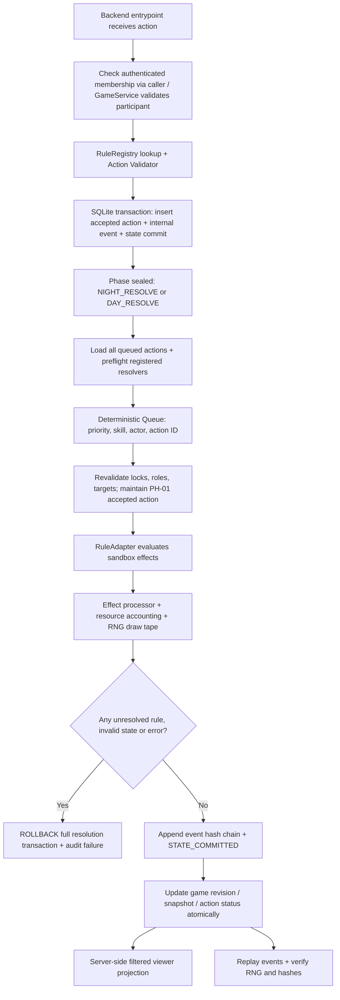

# Sprint 01 architecture, contracts, transaction boundaries

## Source hierarchy

`character.json` (immutable role names/teams/descriptions) + official VH/v1.2/Q13 decisions (immutable 118-rule index) + audited 22 findings. We do not translate the text registry into 97 runnable resolvers until the relevant business predicates and golden fixtures are verified. `RuleRegistry` contains only explicit adapters; unsupported abilities return `RULE_UNRESOLVED`.

## Executable data flow

## Critical transaction properties

- `SqliteRepository.transaction` uses `BEGIN IMMEDIATE / COMMIT / ROLLBACK`; state changes, queue status, random tape, snapshots and event ledger share the **same transaction**.
- Every game state change increments an optimistic revision. State snapshots are recorded after each `STATE_COMMITTED` event. Event IDs are `gameId:sequence` and events are hash chained.
- A declined/failed **batch resolution** does not modify game state or consume resources; unresolved attempts are separately logged in `kernel_audit_failures`, not gameplay events.
- Accepted commands are immutable; repeated idempotency keys with identical command return the prior receipt. Same key with changed payload is rejected.
- `PH-01`: subsequent death alone does not cancel an accepted action. A valid lock can cancel an unprocessed action. Target state/owner role change without a definitive rule returns `RULE_UNRESOLVED` and rolls back.
- The queue's stable sort is a **technical fixture ordering**. Real skill ordering MUST come from the verified ruleset and dependency graph (VH08), not merely numeric role ID.

## RNG contract

`draw(seed,gameId,drawIndex,candidates,reason,actionId)` sorts a unique candidate set, then uses HMAC-SHA256 and 32-bit rejection sampling to avoid modulo bias. Seed is server-only. Every draw saves sorted domain, result, algorithm version and correlation ID inside gameplay events **and** `random_draws`. Replay re-verifies every draw, does not roll a new result. Empty domain is `RULE_UNRESOLVED`, never fallback to another pool.

## State lifecycle

`ROLE_LOCKED → ROLE_ASSIGNED → NIGHT_COLLECT → NIGHT_RESOLVE → [WITCH_WINDOW] → NIGHT_FINALIZE → DAY_DISCUSS → DAY_RESOLVE → next NIGHT_COLLECT`.

The completion transition is **blocked** until full victory predicates are implemented: it cannot fabricate a win. In Sprint 01 `ROLE_ASSIGNED` is a shell state; the service does not distribute actual character skills.

`Participant.life` is an enum distinct from `publicReportedDead`. The current engine does not automatically decide `HIBERNATING`, `PENDING_REVIVAL`, links, or win groups. These are represented in the data model but their domain transitions remain unimplemented.

## Replay type and limits

Replay is **snapshot-in-event + integrity verification**, not a second independent computation of all domain effects. It builds from initial state, applies every validated `STATE_COMMITTED` record, checks revision/sequence/hash chain, checks standalone snapshots and RNG tape, and compares to the persisted end state. For future full-engine independent rule re-execution, add a second replay mode after actual role packs are verified.

## Visibility / security boundaries

- `getInternalState()` / raw events / seed / private logs are **internal-only methods**, not HTTP endpoints.
- `project()` reveals self role/resources and other players' IDs and explicitly public flags; not the other players' roles, actual life, faction or RNG seed.
- `projectVisibleEvents()` checks membership, then event visibility. `SERVER_INTERNAL` events never leave this endpoint; `PLAYER_PRIVATE` needs exact recipient ID; faction/group ACL requires an **event-time frozen audience**. Absent historical audience ⇒ deny.
- `POSTGAME_AUTHORIZED` additionally requires a completed match, and production replay chat must obey `PRIV-01`. There is no postgame gameplay/chat endpoint yet.
- This library does NOT authenticate external web users: the future HTTP gateway must verify sessions and bind actorId to the authenticated identity. Never trust a client supplied `playerId` without gateway auth.
