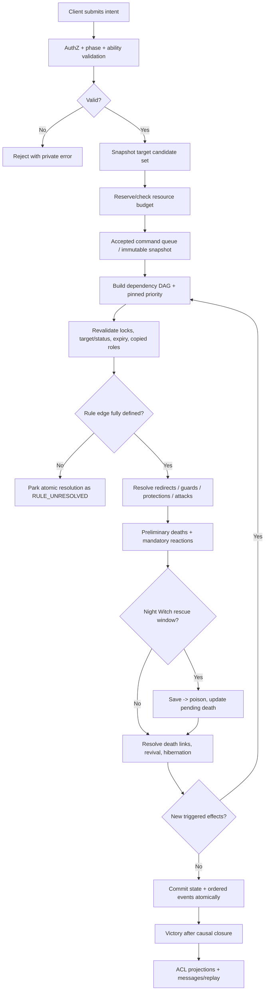

# ACTION_RESOLUTION_PIPELINE — Wolvesville v1.3.1

> Trình tự là **pipeline khái niệm có bước lặp và nhánh**, không phải 11 lệnh thực thi tuần tự một lần. Phân biệt luật đã chốt (mã ở ngoặc) và chiến lược kỹ thuật (ký hiệu `PROPOSAL`).

## Chi tiết checkpoints

| Bước | Điều kiện bắt buộc | Kiểm tra lại? | Luật |
|---|---|---|---|
| 1 Submission | Member/session, revision, phase window, skill granted, intent schema, nonce | Có khi retry | VH08; kiến trúc Wolvesville |
| 2 Action Validation | Actor có quyền nộp, event có trigger, ngưỡng tài nguyên đủ, thời gian còn | Không tự hủy chỉ vì actor chết sau submit | PH-01; Q13-01 |
| 3 Target Validation | Đúng số target, trạng thái hợp lệ, ngục không bị đánh ngoài, AFK random người còn sống hợp lệ | Có, khi redirect/đổi phe/chết xảy ra | SK-07; Q13-02 |
| 4 Resource Validation | Sổ charge/cooldown/per-phase, buff x2 chỉ skill thực dùng, không nhân kho | Có ngay trước effect; debit idempotent | VH05; VH09; VH70; VH85; Q13-01 |
| 5 Action Queue | Snapshot role/target/deck + accepted commands; không resolve theo thời điểm WebSocket | Có khi phase boundary | VH08; PH-01 |
| 6 Priority Resolution | DAG dependencies; khóa trước skill chưa resolve, phục hồi/tạo link theo rule riêng | Có khi role/team đổi hoặc trigger mới | VH08; VH10/VH41; VH04; Q13-03 |
| 7 Effect Resolution | Redirect từng đòn, visited-set chống loop; canTarget, bypass, trap, death provisional | Lặp đến fixed point có bound; nếu cycle chưa rõ thì BLOCK | VH15; VH42; VH51; VH54; VH56; SK-06; Q13-10 |
| 8 State Update | PendingDeath → cure → prolonged → hibernation → real death, link; distinction publicDead | Có sau phản đòn/cứu/linked death | VH26; Q13-05/07/12; LIFE-01/02 |
| 9 Victory Check | Sau khi tất cả event của atomic chain đã resolve; nhiều thắng có thể đồng thắng | Lặp ở checkpoint cuối ngày/đêm, không giữa chain | VH03; VH06; VH58; Q13-05 |
| 10 Event Logging | Causal IDs, RNG, scope, ruleset/version/hash, debit, state delta, visibility; commit cùng state | Replay deterministic | VH62; SK-05; PRIV-01; PROPOSAL |
| 11 Information Projection | Server ACL, public vs private vs group, replay restricted chat | Sau commit và mỗi reconnect | VH57–69; VH77–79; PRIV-01 |

### Sửa thứ tự trình bày mà không sửa nội dung yêu cầu

Để tránh log thiếu hoặc victory quyết định sai, `Event Logging` không phải một bước sau `Victory Check` theo nghĩa **chỉ ghi một lần cuối cùng**. Mỗi intent/draw/effect sinh *đề xuất event* trong transaction, và sau closure mới chốt toàn bộ event + `VictoryEvaluated` và gửi projection. Đây là chiến lược kỹ thuật, không bổ sung luật thắng mới.

## Khi nào tái kiểm tra?

1. **PH-01:** lệnh đã nộp khi actor còn sống, sau đó actor chết: không tự hủy; chỉ kiểm tra xem có khóa hoặc exception khác thật sự tác động đúng lệnh.
2. **VH10/VH41, #11 bảo trì:** lớp khóa trước skill chưa thực thi; nếu có đối kháng lock/maintenance, lấy thứ tự dependency theo VH08/P05.
3. **Q13-01:** mỗi lần nhân đôi use tạo thêm action instance; không nhân `chargesRemaining`. Không dùng skill đêm đó → x2 không có tác dụng. VH05 giải quyết bình cứu ngoại lệ.
4. **VH71/SK-03/Q13-04:** clone skill không tự đổi team; copied charges theo snapshot target; validate entitlements của owner sau event copy.
5. **VH37/Q13-08:** đổi team, tuyển giáo phái và winGroup thành công → cập nhật từng thuộc tính và chat ACL theo event được commit; không tự grant nếu recruitment fail.
6. **VH56/SK-07:** redirect sang target đã ghé → bỏ redirect đó và giữ đích hiện tại; nếu target trong ngục thì phải kiểm tra eligibility, không chỉ nhìn immunity.
7. **VH42/Q13-10/SK-06:** xuyên protection #75 không tự triệt trap phản sát, người cung cấp protection là protector; giải quyết từng Attack ID, dedupe victim death.
8. **W04/Q13-12:** preliminary dead list có người mang hạt để Phù Thủy quyết cứu; nếu cứu được thì không hibernating trong death event đó. Hạt giữ/tiêu hao **UNRESOLVED**.
9. **VH26/Q13-07:** prolong được giữ tới hết hạn rồi mới xét trigger seed; nếu hạt chạy thì HIBERNATING tính quân số nhưng tạm ngưng chat/vote/skill (Q13-05).
10. **VH04/REL-01/03/Q13-03:** links suspended stack phục hồi recent-first sau ưu tiên loại, win/death edges tách ACL chat.
11. **VH03/VH58:** game end chỉ sau causal closure; không kéo dài để revive nếu đã thắng hợp lệ, vẫn tính pending revive và hibernating theo đúng luật.
12. **Q13-06/Q13-11:** false-result RNG phải có tập giá trị và type hợp lệ; nếu tập rỗng dừng đúng branch, không quay về trả thật hoặc tự chọn một role ngoài deck.

## Replay/determinism

Hàm concept: `Resolve(snapshot, acceptedCommandsSorted, pinnedRuleset, rngDrawTape) = (newSnapshot, orderedDomainEvents, projectionsPerViewer)`.

`rngDrawTape` ghi cả candidate list, weights, algorithm version và outcome; random điều kiện (50% Fan Cuồng, 25% Huyết Cảm, giả role, AFK) **không chạy lại ngẫu nhiên lúc replay**.

**Các cổng kỹ thuật:** test equivalence dưới hoán vị thứ tự nhận command hợp lệ; idempotent retry; phase deadline race; event loop finite; ACL không lộ danh tính/người soi/nhóm chat; không sửa snapshot mới hơn bằng client stale revision.
