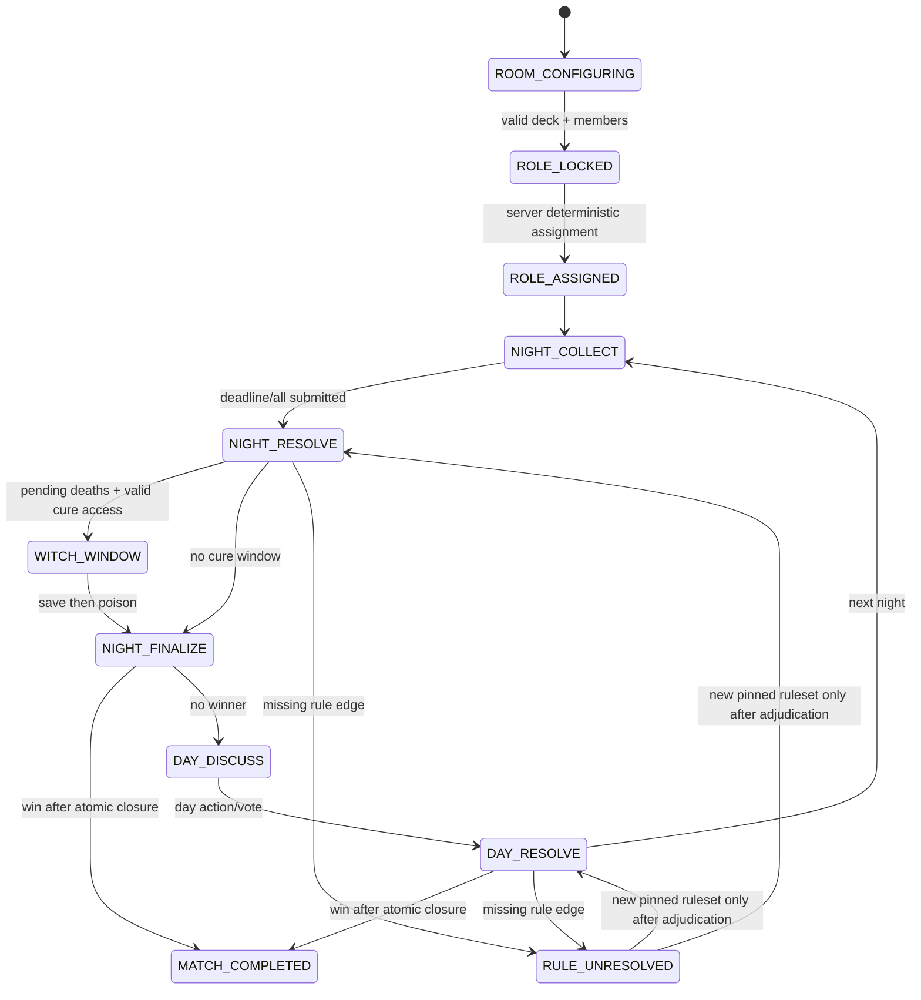

# GAME_STATE_MODEL — Wolvesville v1.3.1

## Phạm vi và phân loại

Đây là **mô hình kỹ thuật đề xuất** để hiện thực các luật đã chốt, không phải phép mở rộng nghiệp vụ. Căn cứ chính: VH03/VH08/VH33/VH56/VH57/VH62/VH74/VH82, PH-01/02/03/04, LIFE-01/02, REL-01/02/03, Q13-03/04/05/07/12, PRIV-01 và tài liệu v1.3.1.

## Machine của trận

### Ràng buộc chuyển

1. `ROLE_LOCKED`: Unique **initialRoleId**; count slots <= 97 với bộ vai hiện tại (ROOM-02, Q13-04). 1 người + AI hợp lệ nếu deck và role predicates cho phép (ROOM-01). Không tái phân vai sau reconnect/host transfer (ROOM-03).
2. `NIGHT_RESOLVE`: không tự cancel lệnh đã nộp khi actor chết (PH-01), nhưng lock chưa thực thi có thể cancel (VH10/VH41).
3. `WITCH_WINDOW`: Phù Thủy thấy **tên** tất cả chết sơ bộ đêm (W04) kể cả người có hạt; cứu trước độc (Q13-12). Chết ban ngày không mở cửa sổ này (VH83).
4. `NIGHT_FINALIZE`: closure của redirect, phản sát, chết thay, hồi sinh/chờ, link và seed; sau closure mới xét thắng VH03.
5. `RULE_UNRESOLVED` là trạng thái kỹ thuật cách ly: không coi là thắng/hòa/cộng điểm, không phát projection sai; không tự động đổi ruleset đang pin giữa ván.

## Participant survival — tách trạng thái vật lý và biểu hiện

| Trường | Đề xuất giá trị | Bất biến | Căn cứ |
|---|---|---|---|
| `survival.life` | `ALIVE`, `PENDING_DEATH`, `DEAD_FINAL`, `PENDING_REVIVAL`, `HIBERNATING`, `PROLONGED` | Không gộp thành `isDead` | VH06/VH82; Q13-05/07/12 |
| `canAct` | derive, không ghi cứng | HIBERNATING false; DEAD_FINAL false nếu không có kỹ năng sau chết; lệnh đã nộp PH-01 vẫn hợp lệ | PH-01; Q13-05 |
| `countForVictory` | derive từ status/team | PENDING_REVIVAL và HIBERNATING vẫn tính quân số; PROLONGED tính tới khi về nghĩa địa | VH06/VH26/VH82; Q13-05 |
| `publicReportedDead` | boolean độc lập | Có thể true khi HIBERNATING mà `life` ≠ DEAD_FINAL | LIFE-02; Q13-12 |
| `sourceTeam/currentTeam` | danh mục phe | Chuyển phe không tự đổi role/aura nếu luật không nói | VH37; VH49; VH71 |
| `initialRoleId/currentRoleId/effectiveSkills` | tách ba trường | Unique ban đầu, trùng currentRole sau biến đổi hợp lệ | Q13-04; VH71 |
| `winGroups[]` | typed ownership | Không mặc định `phe3` là một nhóm thắng chung | VH03/VH58; Q13-08 |

## Skill runtime

- `skillSourceId`, `effectiveSkillId`, `ownerSlotId`, `chargesTotal`, `remaining`, `nightUses`, `dayUses`, `appliedBuffInstances[]`, `cooldownUntil`, `activationTriggers[]`, `pendingCommands[]`.
- `resourceLedger` là log **debit theo effect acceptance**, không tự đoán debit khi command bị hủy. Q13-01: buff x2 chỉ trên kỹ năng dùng trong đêm, charge riêng theo lượt, trừ ngoại lệ VH05.
- `effectQueue` có id, parentId, createdAtSeq, `requires[]`, type, priority, sourceRefs, ttl, status `QUEUED/APPLIED/CANCELLED/EXPIRED/BLOCKED`.
- `Attack` có `attackId`, `visitedTargets[]`, `providers[]`, `bypassTags[]`, `trapId?`, `originalTarget`, `terminalTarget`, `causeId` để chống redirect loop và dedupe chết (VH56, Q13-10).
- `Link` gồm `type`, `active/suspended`, `creationSeq`, `prioritySource`, `parentRestorationId`, `memberIds[]`, `deathEdges[]`, `victoryEdges[]`, `chatChannelIds[]`. Chat không phụ thuộc link thắng (REL-02).

## Sự kiện có thể tái lập

`MatchStarted`, `CommandSubmitted`, `CommandAccepted`, `CommandRejected`, `SkillLocked`, `EffectApplied`, `EffectExpired`, `RngDrawn`, `PreliminaryDeathRecorded`, `Saved`, `TrueDeathFinalized`, `HibernationStarted`, `RevivalScheduled`, `Revived`, `LinkSuspended`, `LinkRestored`, `RoleCopied`, `TeamChanged`, `VoteAdjusted`, `VictoryEvaluated`, `MatchCompleted`, `UnresolvedRuleRaised`.

Các tên event là **gợi ý contract kỹ thuật**. Mỗi event cần `rulesetVersion`, `characterDataHash`, `ruleIds[]`, actor/target slot IDs, visibilityClass, before/after revision, seed/draw info nếu có, causal parent và deterministic event sequence. Log raw không gửi cho client.

## Quyền hiển thị

- `PUBLIC`: công bố tên chết và dữ liệu mà kỹ năng cho phép; không tự lộ vai/nguyên nhân.
- `SELF_PRIVATE`: kết quả soi/cứu/thông báo nhận kỹ năng.
- `TEAM_PRIVATE`: quyền nhóm sói, giáo phái đúng giai đoạn.
- `SKILL_SESSION`: ẩn danh một chiều đúng ngoại lệ; #51 đang `CONFLICTING` với quy tắc chỉ hai phiên DM.
- `ADMIN_AUDIT`: raw event during match (VH62).
- `POSTGAME`: participant được xem diễn biến/vai/kết quả; văn bản chat chỉ từ kênh họ từng đọc được (PRIV-01).

## Giao dịch/đồng thời

- Mỗi ván một revision monotonic, lock theo `(matchId, phaseSeq)` và idempotency `commandId`/`eventId`.
- `resolve` phải có phép rollback/blocked fork khi thiếu luật; không commit nửa chuỗi chết khi hậu quả còn chưa được xác định.
- Duplicate command, retry network, reconnect, bot submit và scheduler timeout là cùng một validation contract.
