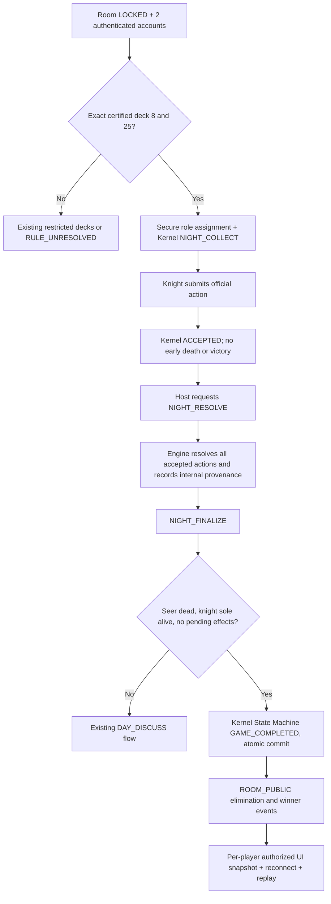

# Sprint 07 — Architecture, Implementation & Changelog

## Luồng server-authoritative thực thi

### Security properties

- Client selects **skill + target intent**, not actor role, faction, RNG, priority or winner.
- `PLAYER_ELIMINATED` public projection contains `playerId` only. Attacker identity, skill ID, death cause, role and source rule stay internal.
- `MATCH_COMPLETED` public projection contains verified `winnerIds` only. Server-only event contains source provenance.
- `ROLE_OBSERVED` is private to inspector even when inspector dies after submitted action. Neither WebSocket peer receives the other's private result.
- `VoteAudit` is stored in internal Kernel archive and is absent from `projectState`, HTTP game view and browser payload.
- On PostgreSQL, game archive, events and room metadata use the existing S02B transaction boundary; Sprint07 adds **no schema migration** (uses existing JSON archive).

## Changelog theo file

| Path | Change | Why / test |
|---|---|---|
| `backend/src/official/solo-rules.ts` | New strict skill and sole-survivor predicate | #8/#25 certified closed deck; S07-01,02,04,05 |
| `backend/src/engine/vote-review.ts` | New pure raw-count audit, always unresolved | V02/V03 not confirmed; S07-03 |
| `backend/src/official/inspection-rules.ts` | Extend exact deck allowlist [8,25], reject duplicate inputs | Restrict accidental broad role usage |
| `backend/src/engine/service.ts` | Implement official death transition, append-only event proof, state-machine completion; internal vote audit | Atomic action resolution, VH03, replay |
| `backend/src/engine/state.ts` | Existing NIGHT_FINALIZE→GAME_COMPLETED path reused unchanged | No parallel state machine |
| `shared/contracts/index.ts` | Optional internal vote review | Persist raw audit without public leak |
| `backend/src/engine/visibility.ts` | Project winner IDs only once game completed | ACL, reconnect |
| `backend/src/game/archive.ts` | Register knight with existing Rule Registry | No duplicate engine |
| `backend/src/game/coordinator.ts` | Conditional completion after night finalized | Business boundary + transaction ordering |
| `backend/src/official/capabilities.ts` | Server-issued skill for #8 | UI not empowered to infer role/action |
| `backend/src/multiplayer/server.ts` | Proper HTTP error for completed games; health service version | API truthfulness |
| `frontend/integration.js` | Host closed-deck selector; server-driven winner screen; terminal banner and role label corrected (no stale day/vote UI or internal Character ID); no target selection after completion | Integrated E2E, approved art unchanged |
| `scripts/serve-03.mjs` | Runtime service name v07 | Honest technical startup |
| `package.json` | Sprint07 scripts, browser suites, live PG test | Reproducible acceptance |
| `tests/sprint07-endgame.test.mjs` | 6 real HTTP/Kernel/SQLite tests | New behavior + security regression |
| `tests/browser_s07_e2e.py` | 2 real Chromium contexts | Real UI, WS and completed endgame |
| `tests/postgres-s07.test.mjs` | Isolated schema live acceptance | Requires real PG before PASS |

## Không có thay đổi phá hủy

- Không sửa source JSON, sổ luật, 207 specs, 107 frontend reference files, migrations 002/004/005/006.
- Không thêm migration: game archive của Sprint02B đã lưu state JSON với `winnerIds`, phase và events; thay đổi optional audit trong JSON.
- Không mở competitive. Không thêm fixture đánh tráo official skills.
