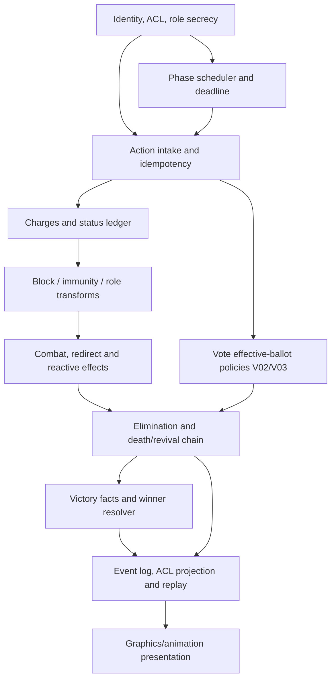

# Sprint 10 — 145 skill branches / mechanism dependency audit

**Source:** `data/rule-intelligence/skills_145.json` (145 rows), 97 characters from `data/character.json`. The `mechanismTags`/`readiness` fields were created by the earlier **technical audit**, not official gameplay law; multiple tags per branch and their totals overlap. Original audit source is not edited. Generate current machine-readable manifest using `npm run rules:build`: `data/rule-intelligence-s10/skill_dependency_audit_145.json`.

## Original 145 branches — technical tag distribution

| Tag from source | Branches | Tag (approximate technical interpretation, NOT source-law claim) |
|---|---:|---|
| AT | 79 | attack / lethal intent |
| DF | 74 | defense / immunity |
| RS | 64 | charge / resource state |
| WC | 39 | win-condition dependency |
| TR | 37 | transfer / transformation |
| IN | 36 | information / inspection |
| LK | 34 | link / group or coupling |
| TM | 31 | temporal/delayed trigger |
| BL | 30 | block/disable |
| RV | 28 | revival/death-state dependency |
| VT | 28 | vote / public decision |
| CH | 24 | chat / permission |
| RN | 14 | random effect |
| NO | 12 | notice/projection |
| OP | 12 | operation/order |
| RF | 6 | redirect/reflection |

Source audit readiness: **70 `IMPLEMENTABLE_WITH_CONSTRAINTS`, 74 `BLOCKED_BY_RULE`, 1 `CONFLICTING`**. These are *audit labels*, not 70 official executable skills. `data/rule-intelligence-s10/character_implementation_matrix_97.json` is the newer **actual implementation** overlay: 11 partially executed characters, 0 complete characters.

## Shared systems — dependency graph

**Implementation-first shared foundations:** ACL + server-verified action → status/resource effects → type-aware combat/death → source-backed winner evaluation → audited events and projection. Voting engine is a parallel dependency joining elimination **only after** V02/V03 user approval. Graphics must not write winners/deaths.

## Concrete next integration sequence

1. Finish officially approved V02/V03 vote policies and targeted regression for #33/#79, then bind hanging **only** to verified role packs.
2. Generalize protection/attack/death typed causes with source predicates; implement reaction graph with atomic queue + repeat guard, without inventing protection priorities.
3. Add source-backed remaining #5 skill and controlled test packs with interactors, then inspect multi-faction winners and pending revival before counting a match completed.
4. Continue 70 source-audited implementable-with-constraints branches only as their target, expiry, result and interactions become provable. Every branch requires registry, actual resolution, ACL, restart/replay and real UI wiring before marking playable.

No assumption that every branch tagged `AT` causes one generic death or that every `WC` uses the same win condition.
