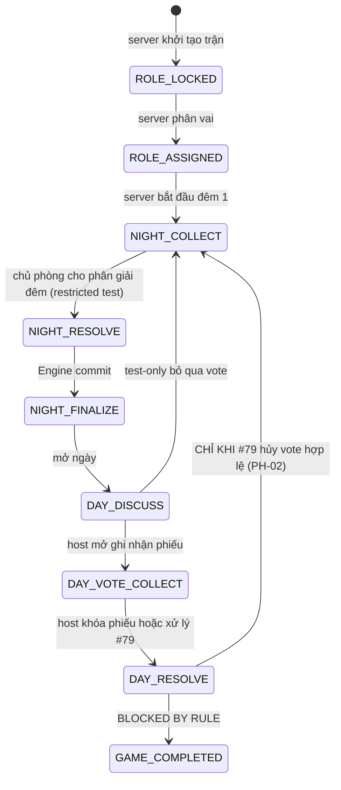

# Gameplay State Diagram

| Trạng thái | Kết quả | Ghi chú |
|---|---|---|
| `ROLE_LOCKED`, `ROLE_ASSIGNED`, `NIGHT_COLLECT` | IMPLEMENTED & TESTED | Backend phân vai bằng RNG, chưa có full match |
| `NIGHT_RESOLVE`, `NIGHT_FINALIZE`, `DAY_DISCUSS` | IMPLEMENTED & TESTED | Night resolution và feedback đúng ACL |
| `DAY_VOTE_COLLECT` | IMPLEMENTED & TESTED | Tiếp nhận phiếu riêng tư, chỉ 1 lần/người trong bộ test |
| `DAY_RESOLVE` | PARTIAL | Chốt phiếu chỉ có kết quả PH-02; không mặc định treo cổ |
| `GAME_COMPLETED` | BLOCKED BY RULE | No legitimate automatic ending; Engine bảo vệ transition |

`DAY_VOTE_COLLECT` được thêm dưới dạng Phase chính thức trong types, nhưng **quyền thu phiếu chỉ bật trong Restricted Official Test**; đây là một giai đoạn kỹ thuật cho flow, không tuyên bố đã hoàn thiện luật biểu quyết.
