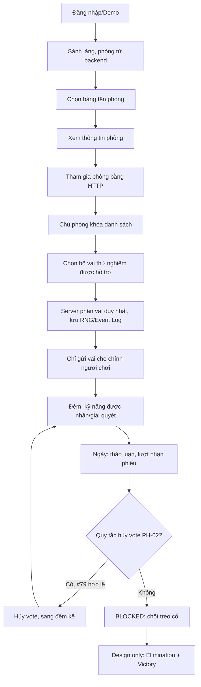

# Match Lifecycle / Lobby → Room → Match

- **IMPLEMENTED & TESTED:** A→M (riêng đường PH-02) và các gameplay test pack trước.
- **PARTIAL:** K (bỏ phiếu chỉ ghi nhận, không có finalVote chung).
- **BLOCKED BY RULE:** N/O; không dùng mock death/winner ở runtime.
- **Thiết kế giữ nguyên:** sân khấu Dark Fantasy, map, vòng bài Bách khoa, kết quả text instant; chỉ bổ sung khu vực voting.
