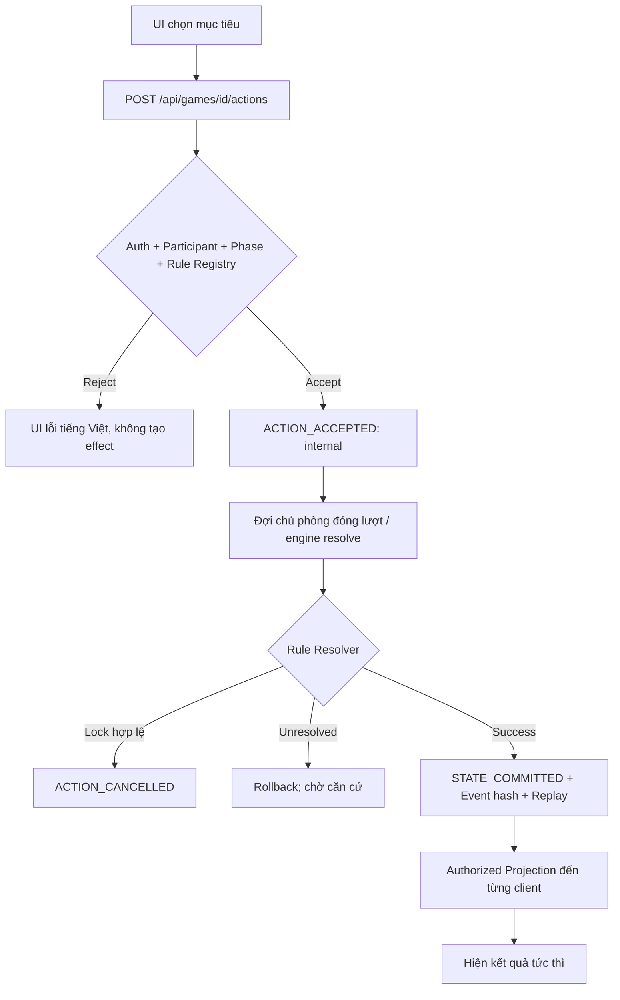

# Player Action Flow

**IMPLEMENTED & TESTED:** auth, server actor, action/idempotency, queue, resolution, locked cancellation, replay, feedback #20/#25/#74/#9/#31/#34/#79. **PARTIAL:** xử lý combat, group-scoped actor outcomes ngoài test decks. **Không dùng:** frontend tính role/priority/RNG/actual result, hoặc `ACCEPTED` như `RESOLVED`.
