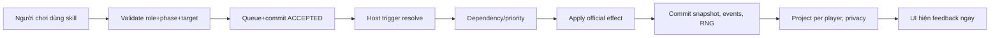

# Skill Resolution Flow / Event → Feedback

- **IMPLEMENTED & TESTED:** #25/#74 soi; #20 phản ứng chấn thương đêm sau; #34 chặn đêm; #31 bảo vệ một đêm; #9 bảo vệ hai đêm; #79 hủy vote và reveal riêng cho wolf khi còn là con sói duy nhất trong bộ bài đóng.
- **PARTIAL:** Các lớp bảo vệ #9/#31 mới được ghi nhận; chưa có pipeline tấn công hợp lệ để sử dụng hấp thụ sát thương.
- **DESIGNED ONLY:** Chuỗi phóng kỹ năng tấn công/bắn/độc và hậu quả sau chết.
- **Nguồn:** `character.json#9,#20,#25,#31,#34,#74,#79`; `VH08`, `VH10`, `VH24`, `PH-01`, `PH-02`; test `tests/sprint06-lifecycle.test.mjs` và test inherited `tests/official-support.test.mjs`.
- **ACL:** `ROLE_OBSERVED` #79 là `PLAYER_PRIVATE`; `VOTING_CANCELLED` là room public nhưng **không chứa vai vừa soi**.
