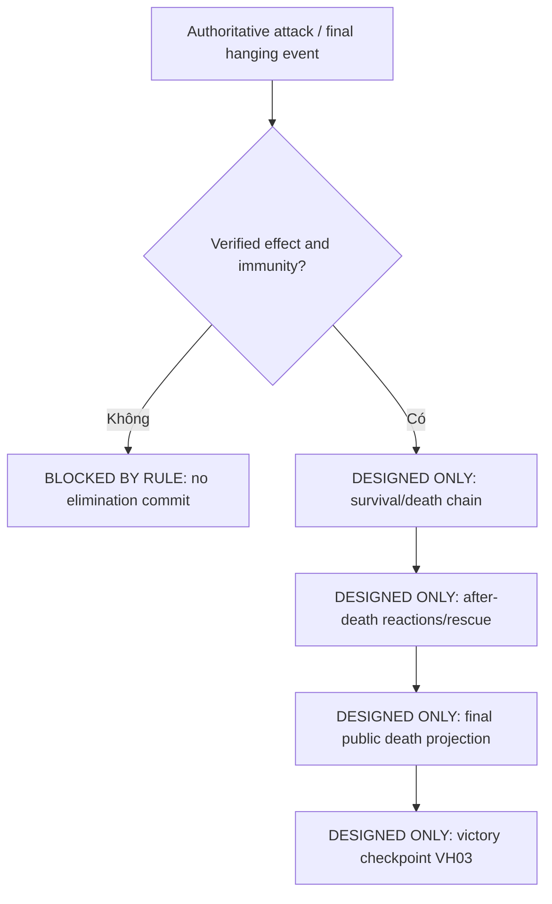

# Death / Elimination Flow — BLOCKED BY RULE

Các trạng thái `ALIVE`, `PENDING_DEATH`, `DEAD_FINAL`, `HIBERNATING`, `PENDING_REVIVAL`, `PROLONGED` đã có trong contracts và trong những nhánh effect riêng lẻ, **không đủ chứng minh cả pipeline đã hoạt động**.

Nguồn xác minh cần giữ: #8 không bị treo khi còn Sói; #28 thắng khi bị treo hợp lệ; #97 ngủ đông không phải chết thật; VH03 cuối chuỗi rồi xét đồng thắng; Q13-05 ngủ đông không hành động hoặc vote; PH-01 actor đã accepted không bị tự hủy khi chết sau đó.

**Cấm phát:** animation chết/đưa ra nghĩa địa khi chỉ có vote intent; không dùng UI “đã treo cổ” hoặc “chết” khi GameState không chứa event đã commit.
