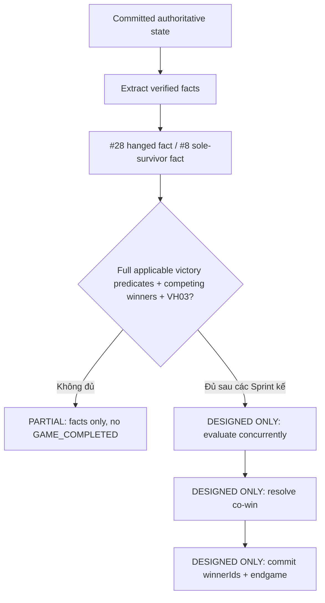

# Endgame / Victory Flow — PARTIAL

**IMPLEMENTED & TESTED:** `evaluateVerifiedVictoryFacts` (#28 hanging after a committed trigger); `evaluateVerifiedSoleSurvivorFacts` (#8 is sole counted survivor); `countsTowardFaction` (ngủ đông, chờ hồi sinh); `canHangHeadlessKnight` (còn Sói thì không treo #8). Đây là các hàm **pure facts**, không kết thúc trận.

**BLOCKED BY RULE / DESIGN:** chung kết phe Dân/Sói/phe Ba, thứ tự tranh thắng, pending after-death chain và kết thúc game thật. `GAME_COMPLETED` vẫn được Kernel từ chối, không có winner giả. Nguyên tắc đồng thắng VH03 không được bỏ qua.
