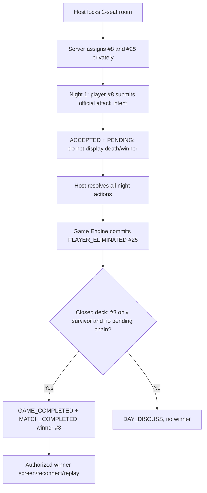

# S07 — Verified Early-Night Endgame vs Generic Gameplay

## Executable vertical slice

### Runtime state table

| Moment | Backend state | Player can see | Status |
|---|---|---|---|
| Room LOCKED + deck selected | Locked room & selection request | Room host selects certified restricted deck | IMPLEMENTED & TESTED |
| Role assignment | `ROLE_ASSIGNED→NIGHT_COLLECT` | Each sees own role only | IMPLEMENTED & TESTED |
| Knight action | `NIGHT_COLLECT`, `ACTION_ACCEPTED` | Sender sees pending, nobody sees death yet | IMPLEMENTED & TESTED |
| Night resolve | `NIGHT_RESOLVE→NIGHT_FINALIZE` | Authorized state updated after commit | IMPLEMENTED & TESTED |
| Knight kills seer in closed deck | `DEAD_FINAL`, death event | Public **victim playerId** only | IMPLEMENTED & TESTED |
| Endgame knight sole survivor | `GAME_COMPLETED`, one winner | Winner panel, lobby navigation | IMPLEMENTED & TESTED |
| Discussion + generic ballot | `DAY_DISCUSS`, `DAY_VOTE_COLLECT`, `DAY_RESOLVE` | Voting receipt/status only | PARTIAL |
| Generic vote→hanging | Missing certified voting adjudication | NOT SHOWN | BLOCKED BY RULE |
| Multi-character general endgame | Missing general co-win chain | NOT SHOWN | BLOCKED BY RULE |

This early-end game **does not show a fabricated ballot/lynching**; designer should not imply that it does. Source: `character.json#8`, `character.json#25`, `VH03`.
