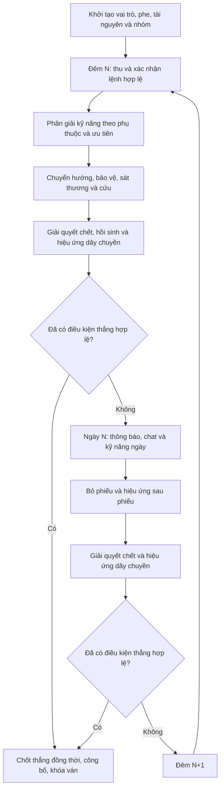

# WOLVESVILLE — ĐẶC TẢ TỔNG HỢP CÂU HỎI, CÂU TRẢ LỜI VÀ LUỒNG VẬN HÀNH

> **Phiên bản:** 21/11/2026 — đã ghi nhận VH01–VH85.  
> **Tính chất:** tài liệu đối chiếu nguồn và quyết định, dành cho thiết kế/triển khai/kiểm thử.  
> **Nguồn đã đọc trực tiếp:** `character.json` (97 nhân vật), `Ma_Soi_Bang_Cau_Hoi_Chua_Ro_100_Char.xlsx` (97 câu hỏi nhân vật, 25 câu hỏi hệ thống, 14 dòng quy tắc đã chốt), `Wolvesville_Bao_cao_tong_hop_quyet_dinh_VH01-VH85.docx` (85 quyết định).  
> **Cảnh báo:** Trạng thái «Đã chốt» trong Excel có thể cũ; những câu trả lời mới VH được ưu tiên. Phần chưa có quyết định không được tự coi là đã giải quyết.

## 1. Phân cấp nguồn và quy ước

- **Ưu tiên 1:** xác nhận trực tiếp mới nhất của người dùng, đặc biệt VH01–VH85 và quy tắc SMU.
- **Ưu tiên 2:** các quy tắc hệ thống đã chốt trong workbook, nếu không trái ưu tiên 1.
- **Ưu tiên 3:** câu trả lời cũ trong Excel, nếu chưa bị quyết định mới thay thế.
- **Ưu tiên 4:** mô tả `character.json` dùng làm luật gốc khi không có quyết định ghi đè.
- **ID nhân vật:** dùng trường `id` trong `character.json`, không dùng số dòng Excel. Người Giao Dịch là ID 22, Tiên Tri là ID 25.
- **Trạng thái câu hỏi:** «Đã chốt mới» = có quyết định VH ghi đè/làm rõ; «Excel cũ» = câu trả lời nguồn chưa xác nhận lại ở lượt VH; «Chưa trả lời» = không suy diễn.
- **Khác biệt kỹ thuật:** «đề xuất luồng thực thi» bên dưới là mô hình triển khai nhằm đáp ứng các quyết định, không phải mọi chi tiết đã được người dùng xác nhận.

### 1.1. Quy ước thời gian
- Một vòng được ký hiệu **Đêm N → Ngày N**. Đêm 1 đi trước Ngày 1 (VH33).
- Một đêm có thể có nhiều pha phụ thuộc; việc gửi lệnh sớm không đồng nghĩa hiệu ứng được thực thi sớm.
- Kết thúc chuỗi sự kiện hiện tại trước khi xét thắng đồng thời (VH03). Không mở đêm/ngày mới chỉ để hồi sinh nếu ván đã kết thúc hợp lệ (VH06).

### 1.2. Tách các thuộc tính người chơi
- `playerId`: định danh người chơi, độc lập với vai trò.
- `roleId`: vai trò hiện tại; `initialRoleId`: vai trò lúc bắt đầu.
- `team`: phe hiện tại; `aura`: hào quang; `winLinks`: liên kết thắng; `status`: sống/chết/chờ hồi sinh; `resources`: tài nguyên còn lại.
- `groupMemberships`: quyền vào nhóm chat; `privateSkillSessions`: các phiên chat kỹ năng ngoại lệ.
- Không tự đổi phe khi chỉ sao chép kỹ năng (VH71); không tự công khai vai trò khi người chơi chết (L02).

## 2. Kiến trúc kênh chat và quyền truy cập

### 2.1. Nguyên tắc bắt buộc
- **Không cho phép DM 1–1 thông thường** giữa người chơi, kể cả khi biết nhau trong ván (VH57).
- Chỉ có **chat chung**, **nhóm chức năng do hệ thống tạo** và **hai loại phiên 1–1 ngoại lệ được kỹ năng cấp quyền** (VH77, VH79).
- **Bị câm:** chặn chat công khai; không mặc định chặn nhóm hợp lệ hoặc quyền bỏ phiếu (VH57, V03).
- Nhóm chat là cơ chế phân quyền theo trạng thái thực tế và chức năng, không dựa trên người chơi tự tạo nhóm.
- Không dùng tên hiển thị, avatar, metadata người gửi, đường dẫn hồ sơ hoặc thông báo đẩy để làm lộ danh tính đã ẩn.

### 2.2. Ma trận kênh
| Kênh | Thành viên | Thời điểm | Danh tính | Quyền / giới hạn | Cơ sở |
|---|---|---|---|---|---|
| Chat chung | Người chơi đủ điều kiện theo trạng thái ván | Ban ngày và các thời điểm hệ thống mở | Hiện danh tính người gửi | Bị câm không được gửi; không tự tạo DM | VH57, V03 |
| Nhóm Sói | Thành viên phe Sói được hệ thống cấp quyền | Theo giai đoạn được phép trong luật phòng | Theo quyền nhóm | Dùng phối hợp kỹ năng và cắn bầy; quyền gia nhập/cắt quyền cập nhật theo đổi phe | Quy ước nhóm chức năng; VH37, VH52 |
| Nhóm giáo phái | Giáo Chủ và thành viên đã được kết nạp hợp lệ | **Chỉ ban ngày** | Danh tính theo nhóm | Không DM riêng giữa Giáo Chủ và tín đồ | VH59, VH78 |
| Nhóm khác theo kỹ năng | Đúng người chơi được chức năng cấp quyền | Theo mô tả kỹ năng | Theo mô tả riêng | Hệ thống tạo/đóng, không phải nhóm tự lập | VH57, VH68 |
| Chat Thầy Đồng ↔ người chết | Đúng 2 người: Thầy Đồng và người chết được chọn | **Ban đêm** | Thầy Đồng biết người chết; người chết chỉ thấy bí danh Thầy Đồng | Ngoại lệ DM kỹ năng, không cấp quyền DM chung | VH77 |
| Chat Quản Ngục ↔ tù nhân | Đúng 2 người: Quản Ngục và người bị giam | **Ban đêm** | Quản Ngục biết tù nhân; tù nhân chỉ thấy bí danh Quản Ngục | Ngoại lệ DM kỹ năng, gắn phiên giam giữ | VH79 |
| Nhật ký quản trị | Quản trị viên có thẩm quyền | Trong ván | Đầy đủ theo quyền | Người chơi không xem log bí mật trong ván; sau ván người tham gia xem lịch sử | VH62 |

### 2.3. Quy tắc an toàn danh tính cho nhóm ẩn danh
1. Hệ thống tạo `sessionId` riêng, gắn với đêm hiện tại và kỹ năng đã xác thực.
2. Bên được ẩn danh dùng bí danh cố định trong phiên, không dùng `playerId`/`roleId` trong dữ liệu gửi xuống phía người còn lại.
3. Chỉ hai thành viên được phép đọc/ghi. Không có tính năng thêm thành viên, chuyển tiếp hồ sơ, nhắc tên bằng tài khoản hoặc mở DM từ phiên.
4. Khi đêm kết thúc hoặc điều kiện kỹ năng hết hiệu lực, phiên bị khóa gửi tin; lưu log theo VH62.
5. Thông báo đẩy và lịch sử trò chuyện cũng phải ẩn danh nhất quán.
6. Đây là **đề xuất triển khai kỹ thuật** để thực hiện VH77/VH79, không mở rộng quyền kỹ năng.

### 2.4. Vòng đời quyền nhóm
1. Khi tạo ván, hệ thống lập nhóm Sói và nhóm đặc thù có điều kiện theo cấu hình nhân vật.
2. Khi Giáo Chủ kết nạp thành công, thông báo riêng cho người được kết nạp và cấp quyền nhóm giáo phái (VH59).
3. Khi chuyển phe, hồi sinh, chết, bị loại hoặc mất quyền, hệ thống đánh giá lại quyền nhóm theo luật áp dụng; **chưa mặc định người chết được giữ quyền chat nhóm** nếu nguồn không nói.
4. Khi bị câm, chỉ thu hồi quyền gửi chat công khai; quyền nhóm hợp lệ không bị thu hồi chỉ vì hiệu ứng câm (VH57).
5. Khi kết thúc ván, đóng quyền gửi và chuyển sang chế độ xem lịch sử theo VH62.

## 3. Luồng hoạt động hệ thống và thứ tự hỏi người chơi

### 3.1. Vòng đời một ván

### 3.2. Thứ tự hệ thống **hỏi/thu lệnh** (đề xuất orchestration)
> Phân biệt rõ: **hỏi người chơi** là thu quyết định; **thực thi** là áp dụng tác động. Nhiều người có thể nhận câu hỏi song song nếu không phụ thuộc nhau. Không được xem thứ tự danh sách này là thứ tự kỹ năng được phân giải tuyệt đối.
| Bước | Hệ thống hỏi hoặc thực hiện |
|---|---|
| 0. Trước đêm | Chốt trạng thái và tài nguyên; xác định người còn quyền; mở/đóng nhóm và phiên kỹ năng; áp dụng hồi sinh/hiệu ứng đến hạn đúng thời điểm. |
| 1. Hỏi kỹ năng đặt điều kiện | Hỏi các kỹ năng chọn trước mục tiêu hoặc đặt điều kiện như Sói Trẻ, liên kết, hạt giống, phong ấn; không thực thi chết tại bước thu lệnh. |
| 2. Hỏi khóa/ngăn chặn | Thu lựa chọn của Sói Ác Mộng, Sói Mộng Du và các kỹ năng chặn. Khi phân giải, lệnh chưa thực thi có thể bị hủy (VH10, VH41). |
| 3. Hỏi bảo vệ/chuyển hướng | Thu lựa chọn Bảo Vệ/Hộ Vệ, Pháp Sư, Thợ Rèn, Chó Canh Gác, Người Gắn Cờ, Ảo Thuật Gia, Thầy Thôi Miên và các vai trò liên quan. |
| 4. Hỏi điều tra/soi | Thu mục tiêu soi. Kết quả chỉ gửi sau khi các hiệu ứng che giấu/hào quang có hiệu lực được phân giải theo P05. |
| 5. Hỏi đổi phe/hồi sinh | Thu lựa chọn Sói Mèo, Giáo Chủ, Sói Chiêu Hồn, Thầy Đồng... nếu có quyền. Chỉ cấp nhóm mới sau khi hành động thành công. |
| 6. Hỏi cắn bầy Sói | Hệ thống hỏi mục tiêu cắn bầy theo luật phòng; áp dụng P04 tối đa 2 mục tiêu dù nhiều hiệu ứng tăng lượt kích hoạt. |
| 7. Hỏi sát thương độc lập | Thu mục tiêu bắn/độc/cầu lửa/trăng sao và các sát thương cá nhân hợp lệ; không mặc định xuyên bảo vệ. |
| 8. Phân giải tiền sát thương | Khóa, tráo đổi, đổi phe, hồi sinh, bảo vệ, chuyển hướng và thứ tự phụ thuộc theo VH08; một hiệu ứng có thể vô hiệu hóa lệnh đã thu. |
| 9. Tính sát thương sơ bộ | Áp dụng sát thương độc lập, cắn bầy, phản đòn, chết thay, bảo vệ/miễn nhiễm và chống vòng lặp chuyển hướng VH56. |
| 10. Hỏi Phù Thủy theo W04 | Hiển thị đúng danh sách tên các trường hợp chết đêm sơ bộ mà Phù Thủy được biết; cho chọn cứu theo tài nguyên; sau đó cho dùng độc theo quy tắc; không cứu chết ban ngày VH83. |
| 11. Chốt chuỗi chết/hồi sinh | Tính lại chết, cứu, liên kết, hạt giống, hồi sinh đến hạn và các sự kiện dây chuyền; không kết thúc giữa chuỗi. |
| 12. Chốt đêm và hỏi tiếp | Kiểm tra thắng; nếu chưa kết thúc thì chuyển sang Ngày N, công bố đúng thông tin cho phép và mở các hành động ngày. |

**Điểm phụ thuộc phải xử lý riêng:**
- Sói Cuồng Yêu làm bánh trước khi tặng (VH21).
- Giáo Chủ kết nạp thành công trước khi hiến tế tín đồ mới cùng đêm (VH50, VH55).
- Thầy Thuốc có thể sử dụng bình vừa chế tạo trong đêm đó (VH46).
- Sói được Sói Chiêu Hồn hồi sinh có thể tham gia cắn nếu lượt cắn chưa phân giải (VH52).
- Khóa kỹ năng xảy ra trước khi kỹ năng bị khóa thực thi; lệnh đã thu nhưng chưa xử lý bị hủy (VH10, VH41).
- Phù Thủy nhận danh sách tên người chết sơ bộ và chỉ có quyền cứu theo giai đoạn đêm (W04, VH83).
- Hệ thống không tự hỏi người chơi đã hết lượt, bị khóa, chết không có quyền hành động hoặc không đủ điều kiện.

### 3.3. Thứ tự thực thi chuẩn (engine, không đồng nhất với thứ tự hỏi)
1. **Xác thực lệnh:** mục tiêu, thời điểm, trạng thái, tài nguyên, giới hạn mỗi đêm/ván.
2. **Khóa và điều kiện:** áp dụng các hiệu ứng chặn, hủy lệnh chưa thực thi; xử lý kỹ năng tạo quyền/đổi phe theo phụ thuộc.
3. **Biến đổi đích:** tráo đổi, chuyển hướng; theo VH56 không quay lại mục tiêu đã đi qua.
4. **Phòng vệ:** lớp bảo vệ, miễn nhiễm, bẫy và các ngoại lệ xuyên phòng vệ (VH13, VH42, VH51, VH54, VH60).
5. **Sát thương:** cắn bầy, tấn công cá nhân, phản sát, chết thay; mỗi đòn tính độc lập nếu luật không gộp.
6. **Cứu và tái tính:** W04; sau cứu tính lại chết dây chuyền, hồi sinh, hiệu ứng chờ.
7. **Ghi nhận trạng thái:** tài nguyên đã tiêu, trạng thái chết/sống, phe, hào quang, nhóm chat, nhật ký bí mật.
8. **Công bố:** chỉ sự kiện được phép công khai; mặc định tên người chết, không tiết lộ vai trò/nguyên nhân (L02, VH07).
9. **Thắng:** xét đồng thời sau chuỗi hiện tại (VH03, VH58), không kéo dài ván trái quy tắc.

### 3.4. Giai đoạn ngày và bỏ phiếu
1. Mở chat chung cho người có quyền, áp dụng câm chỉ trên kênh công khai.
2. Cho thực hiện các kỹ năng ngày hợp lệ, trong đó có thẻ Người Khai Mệnh (VH47), bắn Xạ Thủ theo giới hạn (VH09), sự kiện Người Buôn Bí (VH83).
3. Nếu Sói Hòa Bình dùng kỹ năng ngày: dừng phần còn lại của ngày, giữ sự kiện đã thực thi, bỏ các bước bỏ phiếu chưa thực hiện và chuyển sang đêm theo V01.
4. Nếu có bỏ phiếu: thu phiếu ban đầu → vô hiệu phiếu → ép phiếu Sói Lừa Gạt → Huyết Ấn, theo V02; ghi log cả phiếu gốc và phiếu cuối.
5. Nếu hòa số phiếu cao nhất: không treo cổ (V03). Các điều kiện yêu cầu số phiếu hợp lệ cuối cùng dùng kết quả sau thao túng (VH01).
6. Phân giải chết ban ngày, chết liên kết và các hiệu ứng sau treo; không cho Phù Thủy cứu chết ban ngày do Người Buôn Bí (VH83).
7. Xét thắng sau toàn bộ chuỗi; nếu chưa kết thúc, chuyển Đêm N+1.

## 4. Toàn bộ câu hỏi nhân vật trong Excel và câu trả lời tương ứng (97/97)

> **Nguyên tắc:** Câu hỏi bên dưới giữ theo nội dung Excel. «Trả lời Excel» là bản ghi cũ, không nhất thiết là luật đang có hiệu lực. «Kết luận mới» là phần đã chốt trong VH và có thể ghi đè Excel. Các nhân vật không có VH riêng vẫn có thể chịu quy tắc hệ thống chung.

### NV01 — Sói Đạo Tặc
**Câu hỏi:** Nếu lấy lớp bảo vệ của mục tiêu, lớp bảo vệ đó mất ngay hay chỉ khi bị tấn công; khiên cướp có tồn tại qua nhiều đêm?

**Trả lời Excel:** Khi người chơi bị cướp lớp bảo vệ có lớp bảo vệ thật, mà sói đạo tặc chọn cướp thì người kia mất lớp bảo vệ
Khiên cướp có thể tồn tại qua nhiều đêm, chỉ khi sói đạo tặc bị tâns công mới trừ bỏ lớp này

**Quy tắc hiện hành đã chốt (VH72):** Chỉ cướp thành công một lớp bảo vệ trong cả ván; lớp cướp tồn tại cho đến khi bị đòn hợp lệ tiêu hao.

### NV02 — Dorothy
**Câu hỏi:** Ba đặc điểm có được tích lũy qua nhiều đêm và nếu Dorothy đi thăm người bị giết cùng đêm thì chết theo trước hay sau cứu?

**Trả lời Excel:** 3 đặc điểm được tích nhiều đêm, Dorothy thăm người bị giết thì chết theo, nhưng sách cứu của Phù Thủy sẽ có người mang char Dorothy

**Tình trạng nguồn:** Đã chốt. Chưa có VH riêng được ánh xạ trong tài liệu này; giữ câu trả lời Excel nếu không trái các quy tắc chung.

### NV03 — Sói Tiên Tri
**Câu hỏi:** Khi Sói Tiên Tri xem vai trò nhiều loại kỹ năng, hiển thị loại nào khi mục tiêu có đa kỹ năng; khi bỏ chức năng là quyết định đầu đêm hay ngay lúc chọn?

**Trả lời Excel:** Nếu mục tiêu có đa kĩ năng báo "mục tiêu có đa kĩ năng", khi cả bầy chết hết còn sói tiên tri thì khi đó sói tiên tri thành sói thường bất kể thời gian

**Tình trạng nguồn:** Đã chốt. Chưa có VH riêng được ánh xạ trong tài liệu này; giữ câu trả lời Excel nếu không trái các quy tắc chung.

### NV04 — Người Buôn Bí
**Câu hỏi:** Người được đề nghị có được biết xác suất cụ thể trước khi chấp nhận; hiệu ứng chết ngay 10% có được Phù Thủy cứu trong đêm không?

**Trả lời Excel:** Người được đề nghị không biết xác suất cụ thể, nhưng nếu chết thì Phù cứu được

**Quy tắc hiện hành đã chốt (VH83):** Người nhận không biết xác suất cụ thể (theo Excel). Nếu trúng 10% chết ban ngày thì Phù Thủy không cứu được.

### NV05 — Thẩm Phán Linh Hồn
**Câu hỏi:** Cân Phán Quyết hiện thiện/ác/không xác định hay phân nhóm thiện với phần còn lại; Công Lý Tuyệt Đối bảo vệ tự động hay được hỏi mỗi lần đổi phe?

**Trả lời Excel:** Hiện thiện ác không xác định nhờ vào phe người đó, dù người đó bị chuyển phe hay bị nhiễu cũng soi đúng tuyêtj đối
Công Lý Tuyệt đối hỏi mỗi khi soi ra thiện

**Quy tắc hiện hành đã chốt (VH84):** Cân Phán Quyết trả riêng Thiện / Ác / Không xác định, theo trạng thái thực tế, không bị nhiễu.

### NV06 — Đạo Diễn Tử Thần
**Câu hỏi:** Kẻ Vu Khống không vote đầu tiên do bị câm/khóa vote có tính diễn sai; Kẻ Chết Thay có 2 phiếu bị vô hiệu có tính không?

**Trả lời Excel:** Đều tính hết

**Tình trạng nguồn:** Đã chốt. Chưa có VH riêng được ánh xạ trong tài liệu này; giữ câu trả lời Excel nếu không trái các quy tắc chung.

### NV07 — Diễn Viên Sát Nhân
**Câu hỏi:** Đóng Thế có phản đòn khi nhiều người tấn công đồng thời; Huyết Tế được chọn nhiều người trong danh sách diễn sai hay chỉ một?

**Trả lời Excel:** Phản được nhiều ngươig khi bật đóng thế, Huyết tế môix lần chọn 1

**Tình trạng nguồn:** Đã chốt. Chưa có VH riêng được ánh xạ trong tài liệu này; giữ câu trả lời Excel nếu không trái các quy tắc chung.

### NV08 — Kỵ Sĩ Không Đầu
**Câu hỏi:** Bất tử treo cổ hết hiệu lực ngay khi con sói cuối chết hay từ phiên sau; có bị xử tử ngày bằng kỹ năng không?

**Trả lời Excel:** Khi sói cuối cùng chết thì bỏ hiệu lực bâts tử, có thể chết do bị bắn/ bình độc hay các nguyên nhân khác trừ treo cổ

**Tình trạng nguồn:** Đã chốt. Chưa có VH riêng được ánh xạ trong tài liệu này; giữ câu trả lời Excel nếu không trái các quy tắc chung.

### NV09 — Thiên Sứ Tuyết
**Câu hỏi:** Hai đêm liên tiếp tính từ lúc chọn hay từ đêm kế; lớp bảo vệ có cộng dồn khi các người khác cùng được bảo vệ không?

**Trả lời Excel:** hai đêm tính từ lúc chọn, không cộng dồn khiên

**Tình trạng nguồn:** Chưa trả lời. Chưa có VH riêng được ánh xạ trong tài liệu này; giữ câu trả lời Excel nếu không trái các quy tắc chung.

### NV10 — Sói Kỹ Sư
**Câu hỏi:** Nếu bẫy soi hào quang Không xác định thì đảo thành Thiện đã chốt; còn Ác/Thiện bị đảo thành gì, và bẫy vai trò chính xác phản như thế nào?

**Trả lời Excel:** ác đổi thành thiện, thiện thành ác, bẫy sẽ phản ngược lại kĩ năng chủ động người sử dụng, thực tế hệ thống tính ra kết quả của người bị đặt bẫy như nào thì đảo ngược lại là được, ví dụ Bảo Vệ vệ ai người đó sống, giờ vệ ai người đó chết

**Tình trạng nguồn:** Chưa trả lời. Chưa có VH riêng được ánh xạ trong tài liệu này; giữ câu trả lời Excel nếu không trái các quy tắc chung.

### NV11 — Thợ Rèn Cơ Khí
**Câu hỏi:** Nâng cấp x2 có nhân đôi kỹ năng giới hạn tài nguyên 1 lần không; bảo trì chống bẫy Sói Kỹ Sư ra sao?

**Trả lời Excel:** x2 kĩ năng không giới hạn tài nguyên, chỉ cần đêm đó người chơi muốn dùng kĩ năng gì x2 lên là được, và nếu được x2 sẽ được báo
bảo trì chống nhiễu nghĩa là thợ rèn cơ khí chọn một người, không cần biết người đó bị ai yểm làm Tiên Tri hay char soi sai hay không thì khi có bảo trì giúp mục tiêu đó luôn được soi đúng hào quang

**Tình trạng nguồn:** Chưa trả lời. Chưa có VH riêng được ánh xạ trong tài liệu này; giữ câu trả lời Excel nếu không trái các quy tắc chung.

### NV12 — Búp Bê Nguyền Rủa
**Câu hỏi:** Khi người cầm búp bê không chọn người chuyển hoặc chết trước khi chuyển thì búp bê về đâu; điều kiện thắng xét người từng giữ lúc nào?

**Trả lời Excel:** buộc phải chọn nguời để chuyển, người chuyênr búp bê sẽ không chết trước khi búp bê được chuyển đi
điều kiện thắng chỉ cần biết nếu người cuối cùng bị nguyền rủa còn sống trong khi những người từng bị nguyền chết hết hoặc tất cả ngươif bị nguyền đều chết thì thắng

**Tình trạng nguồn:** Chưa trả lời. Chưa có VH riêng được ánh xạ trong tài liệu này; giữ câu trả lời Excel nếu không trái các quy tắc chung.

### NV14 — Fan Cuồng
**Câu hỏi:** Khi chọn súng 50% Fan Cuồng phải chọn người bắn nào, có được nhắm vào Thần Tượng; nếu đạt điều kiện 2 người cuối thì end ván ngay?

**Trả lời Excel:** fan cuồng có quyền chọn bất cứ ai để bắn trừ thần tượng
ván còn hai người này sống thì end ván

**Tình trạng nguồn:** Chưa trả lời. Chưa có VH riêng được ánh xạ trong tài liệu này; giữ câu trả lời Excel nếu không trái các quy tắc chung.

### NV15 — Ông Kệ Noel
**Câu hỏi:** Hai người trao quà có biết nhau và biết tên Ông Kệ Noel không; khi cả hai không gửi quà random một trong hai hay toàn ván?

**Trả lời Excel:** hai người trao quà không biết nhau, khi không gửi random chết 1 trong hai

**Tình trạng nguồn:** Chưa trả lời. Chưa có VH riêng được ánh xạ trong tài liệu này; giữ câu trả lời Excel nếu không trái các quy tắc chung.

### NV16 — Thần Tình Yêu Hắc Ám
**Câu hỏi:** Tơ hồng 1 người giết ngay lúc chọn hay lúc cuối đêm; nếu 2 người bị nối chết dây chuyền có thể được cứu không?

**Trả lời Excel:** tơ hồng 1 người giết cuối đêm, hai người bị nối chết cùng nhau vẫn được Phù Thủy cứu và sống cả hai

**Tình trạng nguồn:** Chưa trả lời. Chưa có VH riêng được ánh xạ trong tài liệu này; giữ câu trả lời Excel nếu không trái các quy tắc chung.

### NV17 — Phù Thủy Cấm Kỵ
**Câu hỏi:** Độc gieo đêm N khóa Sói/Phe Ba đêm N+1: nếu mục tiêu chuyển sang Dân trước khi phát tác thì bỏ khóa chứ?

**Trả lời Excel:** nếu chuyển sang dân thì bỏ khóa

**Quy tắc hiện hành đã chốt (VH85):** Ánh Sao Báo Thù nhân đôi số lượt dùng kỹ năng trong đêm; người nhận được báo; không vượt tài nguyên hữu hạn hoặc P04.

### NV18 — Nữ Tu Huyết Thệ
**Câu hỏi:** Thiêng Khí Phán Xét công khai cả hai role đã chốt; Ánh Sao Báo Thù tăng lượt có vượt giới hạn tài nguyên và người nhận có biết không?

**Trả lời Excel:** thiêng khí phán xét lộ công khai danh tính Nữ Tu  huyết thệ và cả người bị phán xét 
ánh sao báo thù không giới hạn tài nguyên x2, chỉ cần đêm đó dùng chức năng gì đều x2, người nhận biết mình được x2 kĩ năng

**Quy tắc hiện hành đã chốt (VH71):** Chỉ sao chép kỹ năng mục tiêu; vẫn là phe Sói và thắng theo phe Sói.

### NV20 — Sói Biến Hình
**Câu hỏi:** Sao chép vai khi mục tiêu chết sáng hôm sau: Sói Biến Hình giữ phe Sói hay nhận luôn phe/điều kiện thắng của mục tiêu?

**Trả lời Excel:** nhận phe của mục tiêu nhưng vẫn là sói

**Tình trạng nguồn:** Chưa trả lời. Chưa có VH riêng được ánh xạ trong tài liệu này; giữ câu trả lời Excel nếu không trái các quy tắc chung.

### NV21 — Kẻ Mặc Cả Bóng Tối
**Câu hỏi:** Giao kèo cần nhận lời ngay đêm hay sáng hôm sau; 2 đêm không thành công và các nhiệm vụ đơn độc có xét thắng ngay khi hoàn tất không?

**Trả lời Excel:** giao kèo cần nhận lời ngay, 2 đêm không thành công thì sau khi hoàn thành nhiệm vụ đơn độc là thắng

**Quy tắc hiện hành đã chốt (VH74):** Các hiệu ứng tăng lượt cắn của bầy Sói không cộng dồn; tối đa hai mục tiêu/đêm.

### NV23 — Sói Gai Độc
**Câu hỏi:** Hiệu ứng bị thương khi bị bắn và soi xảy ra trước hay sau kết quả soi/đạn; cùng lúc nhiều người bị phản thương không?

**Trả lời Excel:** Xảy ra sau khi soi/ đạn, có thể phản thương nhiều người cùng lúc

**Quy tắc hiện hành đã chốt (VH82):** Sau lần chết đầu tiên, trong thời gian chờ hồi sinh vẫn tính quân số phe Dân theo VH06.

### NV24 — Sói Khát Máu
**Câu hỏi:** Hai người chết trong một buổi sáng có bao gồm chết khi thảo luận và treo cổ; cộng dồn với Sói Con và Sói Thủ Lĩnh không?

**Trả lời Excel:** Có cộng dồn

**Quy tắc hiện hành đã chốt (VH79):** Quản Ngục được chat riêng 1–1 ẩn danh với tù nhân ban đêm; Quản Ngục biết tù nhân, tù nhân không biết Quản Ngục.

### NV25 — Người Giao Dịch
**Câu hỏi:** Người nhận đề nghị đổi chức năng có được biết người đề nghị là ai; sau hoán đổi giữ phe cũ hay phe của vai mới?

**Trả lời Excel:** không biết người đề nghị là ai, nhưng người giao dịch chỉ giao dịch thành công với phe dân nên sẽ không đổi phe, bất kể giao dịch ai cũng phe dân mới thành công

**Tình trạng nguồn:** Chưa trả lời. Chưa có VH riêng được ánh xạ trong tài liệu này; giữ câu trả lời Excel nếu không trái các quy tắc chung.

### NV26 — Xạ Thủ Linh Hồn
**Câu hỏi:** Xạ Thủ Linh Hồn chết lần đầu có được tính vào đếm phe và xét thắng tạm thời; khi hồi sinh bí mật hiển thị nhân vật với người chơi thế nào?

**Trả lời Excel:** không tính đếm phe và thắng tạm thời, khi hồi sinh bí mật, hệ thống mỗi đêm hỏi Xạ Thủ linh hồn mỗi đêm bắn ai, sẽ không công khai Xạ Thủ Linh Hồn còn sống

**Quy tắc hiện hành đã chốt (VH73, VH76, VH77):** Hồi sinh một người chết bất kỳ thuộc mọi phe và thời điểm, một lần/ván; ngoại trừ Hắc Tinh ID46, Bạch Sát ID47, Thiên Thần ID53. Chat 1–1 ẩn danh ban đêm với người chết; Thầy Đồng biết người chết, chiều ngược lại không.

### NV27 — Quản Ngục
**Câu hỏi:** Quản Ngục bắn người bị giam có vượt miễn nhiễm ngục không?

**Trả lời Excel:** Quản Ngục có thể bắn chết người bị giam

**Tình trạng nguồn:** Chưa trả lời. Chưa có VH riêng được ánh xạ trong tài liệu này; giữ câu trả lời Excel nếu không trái các quy tắc chung.

### NV28 — Tiên Tri
**Câu hỏi:** Theo luật đã chốt Tiên Tri thông thường chỉ soi hào quang, không phải vai trò chi tiết: có áp dụng cho tất cả mục tiêu hay ngoại lệ nào?

**Trả lời Excel:** Áp dụng tất cả mục tiêu không có ngoại lệ, chỉ soi hào quang

**Tình trạng nguồn:** Chưa trả lời. Chưa có VH riêng được ánh xạ trong tài liệu này; giữ câu trả lời Excel nếu không trái các quy tắc chung.

### NV29 — Thầy Đồng
**Câu hỏi:** Thầy Đồng hồi sinh người chết cùng đêm trước khi hay sau Phù Thủy; hồi sinh được người chết vì treo cổ hôm trước không?

**Trả lời Excel:** hồi sinh sau Phù Thủy, nghĩa là người đã bị phù bỏ qua, tất cả người chết đều có thể được hồi sinh

**Quy tắc hiện hành đã chốt (VH05, VH60, VH83):** Bình cứu x2 cứu được hai người trong cùng đêm bằng một bình; bình độc bị bảo vệ hợp lệ chặn vẫn tiêu hao; không cứu tử vong ban ngày do Người Buôn Bí.

### NV30 — Cupid
**Câu hỏi:** Ghép cặp chuyển sang phe riêng khi nào; Cupid tự ghép thì cần 1 người hay 2; khi cặp chết Cupid thành Dân ngay khi nào?

**Trả lời Excel:** ngay khi ghép cặp, hệ thống tạo một box chat cho hai người này đồng thời add Cupid vào box chat đó
Cupid tự ghép cần thêm 1 người
ngay khi cặp chết Cupid thành dân

**Tình trạng nguồn:** Chưa trả lời. Chưa có VH riêng được ánh xạ trong tài liệu này; giữ câu trả lời Excel nếu không trái các quy tắc chung.

### NV31 — Thằng Ngố
**Câu hỏi:** Thằng Ngố chết do treo cổ là thắng tức thì đã chốt; nếu bị treo nhưng được miễn nhiễm không chết thì có thắng không?

**Trả lời Excel:** không thắng

**Tình trạng nguồn:** Chưa trả lời. Chưa có VH riêng được ánh xạ trong tài liệu này; giữ câu trả lời Excel nếu không trái các quy tắc chung.

### NV32 — Phù Thủy
**Câu hỏi:** Phù Thủy nhận tên người chết sơ bộ, cứu trước độc và trừ bình ngay đã chốt; có thể cứu chính mình nếu là nạn nhân không?

**Trả lời Excel:** Có thể tự cứu chính mình

**Tình trạng nguồn:** Chưa trả lời. Chưa có VH riêng được ánh xạ trong tài liệu này; giữ câu trả lời Excel nếu không trái các quy tắc chung.

### NV33 — Sói Trắng
**Câu hỏi:** Sói Trắng giết sói mỗi hai đêm: đêm 2,4,... hay đêm 1,3,...; nếu Sói Trắng là sói cuối còn sống thì thắng ngay dù còn Dân/Phe Ba?

**Trả lời Excel:** đêm 2, 4
sói trắng là phe 3, nên tổng hợp và xét thêm điều kiện thắng tôi đã đưa

**Tình trạng nguồn:** Chưa trả lời. Chưa có VH riêng được ánh xạ trong tài liệu này; giữ câu trả lời Excel nếu không trái các quy tắc chung.

### NV34 — Bảo Vệ
**Câu hỏi:** Bảo Vệ có được tự vệ và bảo vệ một người bị cắn xuyên khiên không; khi 2 nguồn đánh cùng lúc lớp vệ chặn mấy lần?

**Trả lời Excel:** bảo vệ có thể tự vệ, có thể vệ người bị cắn xuyên khiên nhưng khiên không có tác dụng

**Tình trạng nguồn:** Chưa trả lời. Chưa có VH riêng được ánh xạ trong tài liệu này; giữ câu trả lời Excel nếu không trái các quy tắc chung.

### NV35 — Xạ Thủ
**Câu hỏi:** Ba viên đạn có thể bắn nhiều viên trong cùng phiên ngày/đêm không; chết do bắn ngày có được Phù Thủy cứu không?

**Trả lời Excel:** *Chưa có câu trả lời trực tiếp trong bảng.*

**Quy tắc hiện hành đã chốt (VH11):** Phản chiếu hào quang nạn nhân Sói cắn gần nhất; nếu chưa từng có nạn nhân thì dùng hào quang Sói thật.

### NV36 — Sói Lừa Gạt
**Câu hỏi:** Khi Sói Lừa Gạt ép phiếu thì người bị ép có biết không; ảo ảnh chỉ áp dụng soi hào quang hay cả soi role thật?

**Trả lời Excel:** *Chưa có câu trả lời trực tiếp trong bảng.*

**Quy tắc hiện hành đã chốt (VH12, VH13):** Dùng cầu lửa và khiên cùng đêm, tiêu hao riêng; cầu lửa không xuyên bảo vệ.

### NV37 — Sói Mộng Du
**Câu hỏi:** Sói Mộng Du chọn đúng người từng thuộc Dân nhưng vừa đổi phe còn khóa không; khóa đêm hiện tại nếu người đó đã nộp lệnh thì sao?

**Trả lời Excel:** *Chưa có câu trả lời trực tiếp trong bảng.*

**Quy tắc hiện hành đã chốt (VH14, VH15):** Tráo đổi mục tiêu từ đêm kích hoạt qua ngày kế tiếp; đổi từng đòn độc lập, hai người có thể cùng chết.

### NV38 — Sói Gương
**Câu hỏi:** Sói Gương phản chiếu vai trò/hào quang người sói giết gần nhất theo đêm trước; nếu không có nạn nhân thì phản chiếu gì?

**Trả lời Excel:** *Chưa có câu trả lời trực tiếp trong bảng.*

**Quy tắc hiện hành đã chốt (VH16):** Tối đa một linh hồn mỗi đêm.

### NV39 — Pháp Sư
**Câu hỏi:** Pháp Sư ném lửa bắt buộc mỗi đêm hay tùy chọn; cầu lửa xuyên bảo vệ không; khiên dùng cùng đêm với lửa được không?

**Trả lời Excel:** *Chưa có câu trả lời trực tiếp trong bảng.*

**Quy tắc hiện hành đã chốt (VH17, VH18):** Ngưỡng thắng giết Sói > nửa số Sói ban đầu; bắt nhầm Dân mất xe đúng một đêm sau.

### NV40 — Ảo Thuật Gia
**Câu hỏi:** Ảo Thuật Gia tráo đổi hiệu ứng theo cặp đến hết ngày hay chỉ trong đêm; khi cả 2 cùng bị tấn công giải quyết ra sao?

**Trả lời Excel:** *Chưa có câu trả lời trực tiếp trong bảng.*

**Quy tắc hiện hành đã chốt (VH19):** Không trả lời đúng hạn thì người bị hỏi chết.

### NV41 — Nhà Sưu Tầm Linh Hồn
**Câu hỏi:** Nhà Sưu Tầm Linh Hồn hút được nhiều hồn nếu chết dây chuyền cùng đợt không; khi nào hiện kết quả và mất kỹ năng tích lũy?

**Trả lời Excel:** *Chưa có câu trả lời trực tiếp trong bảng.*

**Tình trạng nguồn:** Chưa trả lời. Chưa được chốt riêng trong Excel; chỉ áp dụng mô tả gốc và các quy tắc hệ thống có liên quan.

### NV42 — Kẻ Trộm Chó
**Câu hỏi:** Kẻ Trộm Chó không có Exciter trong mấy đêm khi bị đập; tỷ lệ hơn nửa số Sói tính ở đầu ván hay số Sói hiện tại?

**Trả lời Excel:** *Chưa có câu trả lời trực tiếp trong bảng.*

**Quy tắc hiện hành đã chốt (VH20):** Người còn sống của cặp đôi cũ có thể tố cáo riêng trong cả ngày lẫn đêm.

### NV43 — Hoàng Hậu
**Câu hỏi:** Hoàng Hậu hỏi A/B thì câu hỏi do Hoàng Hậu tự soạn hay hệ thống chuẩn bị; nếu người trả lời không đáp thì chết không?

**Trả lời Excel:** *Chưa có câu trả lời trực tiếp trong bảng.*

**Tình trạng nguồn:** Chưa trả lời. Chưa được chốt riêng trong Excel; chỉ áp dụng mô tả gốc và các quy tắc hệ thống có liên quan.

### NV44 — Cupid Hắc Ám
**Câu hỏi:** Cặp ngoại tình chọn sau Cupid: Cupid Hắc Ám có được biết cặp gốc; cặp cũ biết có ngoại tình không?

**Trả lời Excel:** *Chưa có câu trả lời trực tiếp trong bảng.*

**Quy tắc hiện hành đã chốt (VH21):** Được làm bánh và tặng bánh cùng đêm, làm trước tặng sau.

### NV45 — Cặp Đôi Ngoại Tình
**Câu hỏi:** Khi cặp cũ tố ngoại tình, đối tượng nào chết nếu tố sai; hành động tố thực hiện trong ngày hay đêm và có công khai không?

**Trả lời Excel:** *Chưa có câu trả lời trực tiếp trong bảng.*

**Tình trạng nguồn:** Chưa trả lời. Chưa được chốt riêng trong Excel; chỉ áp dụng mô tả gốc và các quy tắc hệ thống có liên quan.

### NV46 — Sói Bắn Tỉa
**Câu hỏi:** Sói Bắn Tỉa trong JSON chỉ ghi 2 đạn, không có đoán vai: có bổ sung cơ chế đoán role mới hay giữ bắn thường?

**Trả lời Excel:** *Chưa có câu trả lời trực tiếp trong bảng.*

**Quy tắc hiện hành đã chốt (VH23, VH76):** Khi chết khóa toàn bộ kỹ năng phe Sói, kể cả cắn bầy; không thể được Thầy Đồng hồi sinh.

### NV47 — Sói Cuồng Yêu
**Câu hỏi:** Sói Cuồng Yêu làm bánh và tặng bánh cùng một đêm được không; người nhận thấy danh tính Sói Cuồng Yêu trước khi chấp nhận không?

**Trả lời Excel:** *Chưa có câu trả lời trực tiếp trong bảng.*

**Quy tắc hiện hành đã chốt (VH24, VH76):** Ngoại lệ miễn khóa chỉ đúng vai trò được nêu; không thể được Thầy Đồng hồi sinh.

### NV48 — Người Cầu Nguyện
**Câu hỏi:** Người Cầu Nguyện nhận kỹ năng theo hào quang của người chết ở thời điểm nào; được chọn nguyện người vừa chết trong đêm không?

**Trả lời Excel:** *Chưa có câu trả lời trực tiếp trong bảng.*

**Tình trạng nguồn:** Chưa trả lời. Chưa được chốt riêng trong Excel; chỉ áp dụng mô tả gốc và các quy tắc hệ thống có liên quan.

### NV49 — Hắc Tinh
**Câu hỏi:** Khi Hắc Tinh chết: khóa tất cả Sói gồm cả cắn thường hay chỉ kỹ năng riêng, hiệu ứng kéo dài tới hết ván không?

**Trả lời Excel:** *Chưa có câu trả lời trực tiếp trong bảng.*

**Quy tắc hiện hành đã chốt (VH25):** Tối đa hai lần ảo ảnh trong cả ván, mỗi lần một đêm.

### NV50 — Bạch Sát
**Câu hỏi:** Khi Bạch Sát chết: những vai Dân ngoại lệ phân loại theo tên hay loại kỹ năng; sau hồi sinh có phục hồi chức năng không?

**Trả lời Excel:** *Chưa có câu trả lời trực tiếp trong bảng.*

**Tình trạng nguồn:** Chưa trả lời. Chưa được chốt riêng trong Excel; chỉ áp dụng mô tả gốc và các quy tắc hệ thống có liên quan.

### NV51 — Sói Thủ Lĩnh
**Câu hỏi:** Khi Sói Thủ Lĩnh là Sói cuối, quyền cắn 2 mạng có cộng với Sói Khát Máu/Sói Con hay bị giới hạn 2?

**Trả lời Excel:** *Chưa có câu trả lời trực tiếp trong bảng.*

**Quy tắc hiện hành đã chốt (VH26):** Người được kéo dài sống tính vào quân số cho đến khi trở về nghĩa địa.

### NV52 — Sói Ảo Ảnh
**Câu hỏi:** Sói Ảo Ảnh 2 lần trong đêm hay 2 lần trong ván; gây nhiễu chỉ Tiên Tri hay mọi kỹ năng soi?

**Trả lời Excel:** *Chưa có câu trả lời trực tiếp trong bảng.*

**Quy tắc hiện hành đã chốt (VH27):** Hai chó khác chức năng có thể bảo vệ cùng mục tiêu trong một đêm.

### NV53 — Sói Gây Tê
**Câu hỏi:** Sói Gây Tê mô tả khóa đêm và câm sáng: khóa cùng đêm hay đêm kế; khi phải nghỉ một đêm có được Sói bầy cắn bình thường không?

**Trả lời Excel:** *Chưa có câu trả lời trực tiếp trong bảng.*

**Quy tắc hiện hành đã chốt (VH76):** Thiên Thần không thể được Thầy Đồng hồi sinh.

### NV54 — Người Lái Đò
**Câu hỏi:** Người Lái Đò kéo dài cuộc sống của người chết tới hết vote: người đó có tính vào kiểm tra số Dân/Sói trong ngày không?

**Trả lời Excel:** *Chưa có câu trả lời trực tiếp trong bảng.*

**Quy tắc hiện hành đã chốt (VH28):** Công khai vai trò thật của mục tiêu cho cả làng.

### NV55 — Chó Canh Gác
**Câu hỏi:** Chó Canh Gác dùng được tối đa hai đêm tổng hay mỗi chó hai lần; có được trùng hai chó trên một người không?

**Trả lời Excel:** *Chưa có câu trả lời trực tiếp trong bảng.*

**Tình trạng nguồn:** Chưa trả lời. Chưa được chốt riêng trong Excel; chỉ áp dụng mô tả gốc và các quy tắc hệ thống có liên quan.

### NV56 — Thiên Thần
**Câu hỏi:** Thiên Thần chết kéo người được vệ ngay dù đã đổi người bảo vệ chưa; bắn sáng sau cứu thành công có công khai Thiên Thần không?

**Trả lời Excel:** *Chưa có câu trả lời trực tiếp trong bảng.*

**Quy tắc hiện hành đã chốt (VH29):** Bảo vệ hợp lệ có thể cứu Kỹ Nữ khi ghé mục tiêu nguy hiểm.

### NV57 — Người Canh Gác
**Câu hỏi:** Người Canh Gác tiết lộ là soi role thật hay công bố công khai vai trò; bị chặn vote có còn hành động ngày này không?

**Trả lời Excel:** *Chưa có câu trả lời trực tiếp trong bảng.*

**Tình trạng nguồn:** Chưa trả lời. Chưa được chốt riêng trong Excel; chỉ áp dụng mô tả gốc và các quy tắc hệ thống có liên quan.

### NV58 — Sói Thạch
**Câu hỏi:** Sói Thạch bảo vệ khỏi dân ngày/đêm: treo cổ có tính nguồn từ dân không; cứu thành công mới đổi thành Sói thường đúng không?

**Trả lời Excel:** *Chưa có câu trả lời trực tiếp trong bảng.*

**Quy tắc hiện hành đã chốt (VH30):** Hai mục tiêu khác phe bị xét chết độc lập; cứu một không cứu người kia.

### NV59 — Kỹ Nữ
**Câu hỏi:** Kỹ Nữ thăm kẻ giết solo thì chết dù mục tiêu không tấn công; nếu có bảo vệ thì chống được chết do ghé thăm không?

**Trả lời Excel:** *Chưa có câu trả lời trực tiếp trong bảng.*

**Quy tắc hiện hành đã chốt (VH31):** Chấn thương khóa hết ngày hiện tại và đêm kế tiếp.

### NV60 — Kẻ Biến Hình
**Câu hỏi:** Kẻ Biến Hình giết rồi nhận khả năng hay chỉ giả danh vai; có chuyển phe và điều kiện thắng theo vật chủ không?

**Trả lời Excel:** *Chưa có câu trả lời trực tiếp trong bảng.*

**Quy tắc hiện hành đã chốt (VH32):** Kế thừa số tài nguyên còn lại của vai trò người chết.

### NV61 — Thám Tử Ác Ma
**Câu hỏi:** Thám Tử Ác Ma chọn hai người khác phe và có người được cứu thì phần kia vẫn chết không; nếu chọn chính mình miễn nhiễm không?

**Trả lời Excel:** *Chưa có câu trả lời trực tiếp trong bảng.*

**Tình trạng nguồn:** Chưa trả lời. Chưa được chốt riêng trong Excel; chỉ áp dụng mô tả gốc và các quy tắc hệ thống có liên quan.

### NV62 — Ná Thủ
**Câu hỏi:** Ná Thủ chấn thương ngăn hành động hiện tại & kế tiếp là phiên ngày/đêm hay hành động kế; ném đá có công khai ngay không?

**Trả lời Excel:** *Chưa có câu trả lời trực tiếp trong bảng.*

**Tình trạng nguồn:** Chưa trả lời. Chưa được chốt riêng trong Excel; chỉ áp dụng mô tả gốc và các quy tắc hệ thống có liên quan.

### NV63 — Người Gọi Hồn
**Câu hỏi:** Người Gọi Hồn sao chép char chết bao gồm tài nguyên và phe không; thời điểm trở về được mô tả hơi chồng với vote kế tiếp?

**Trả lời Excel:** *Chưa có câu trả lời trực tiếp trong bảng.*

**Quy tắc hiện hành đã chốt (VH61):** Chuyển hướng vào mục tiêu miễn nhiễm vẫn tính thành công và gây cooldown đêm kế.

### NV64 — Thiện Xạ
**Câu hỏi:** Thiện Xạ bắn vào ngày kế tiếp lúc thảo luận hay sau bỏ phiếu; tên mục tiêu đã đánh dấu có bị báo cho họ không?

**Trả lời Excel:** *Chưa có câu trả lời trực tiếp trong bảng.*

**Tình trạng nguồn:** Chưa trả lời. Chưa được chốt riêng trong Excel; chỉ áp dụng mô tả gốc và các quy tắc hệ thống có liên quan.

### NV65 — Kẻ Xúi Giục
**Câu hỏi:** Kẻ Xúi Giục hội viên được hệ thống random hay do người chơi chọn; điều kiện thắng nhóm đủ khi còn 3 người hay cần tiêu diệt phe khác?

**Trả lời Excel:** *Chưa có câu trả lời trực tiếp trong bảng.*

**Tình trạng nguồn:** Chưa trả lời. Chưa được chốt riêng trong Excel; chỉ áp dụng mô tả gốc và các quy tắc hệ thống có liên quan.

### NV66 — Người Gắn Cờ
**Câu hỏi:** Người Gắn Cờ bảo vệ và chuyển hướng phải chọn 2 người khác nhau; nếu người chuyển hướng có miễn nhiễm có tiêu hao lượt không?

**Trả lời Excel:** *Chưa có câu trả lời trực tiếp trong bảng.*

**Quy tắc hiện hành đã chốt (VH34):** Biết danh tính người được bảo vệ, không biết người bảo vệ.

### NV67 — Người Rung Chuông
**Câu hỏi:** Người Rung Chuông có được thay cả hai mục tiêu qua các đêm; nếu cả hai cùng chết thì nhận thông tin gì?

**Trả lời Excel:** *Chưa có câu trả lời trực tiếp trong bảng.*

**Quy tắc hiện hành đã chốt (VH35, VH70):** Có sẵn 2 khiên và 1 kiếm; tối đa một khiên và một kiếm trong cùng đêm.

### NV68 — Sói Độc Tố
**Câu hỏi:** Sói Độc Tố xuyên được mọi lớp khiên hay chỉ khiên thường; độc đặt đêm N cắn đêm N+1 đúng không?

**Trả lời Excel:** *Chưa có câu trả lời trực tiếp trong bảng.*

**Quy tắc hiện hành đã chốt (VH36):** Phải chọn sẵn mục tiêu khi còn sống; chưa chọn thì không có chết liên kết.

### NV69 — Người Gác Đêm
**Câu hỏi:** Người Gác Đêm quan sát ai được bảo vệ là biết tên người được vệ hay cả người đã vệ; thông báo riêng lúc nào?

**Trả lời Excel:** *Chưa có câu trả lời trực tiếp trong bảng.*

**Quy tắc hiện hành đã chốt (VH37):** Người được đổi sang phe Sói nhận thông báo riêng, không công khai.

### NV70 — Thợ Rèn
**Câu hỏi:** Thợ Rèn tạo khiên/kiếm trước rồi cấp phát sau hay sử dụng trực tiếp vào mục tiêu; có giới hạn mỗi đêm dùng bao nhiêu đồ?

**Trả lời Excel:** *Chưa có câu trả lời trực tiếp trong bảng.*

**Tình trạng nguồn:** Chưa trả lời. Chưa được chốt riêng trong Excel; chỉ áp dụng mô tả gốc và các quy tắc hệ thống có liên quan.

### NV71 — Sói Trẻ
**Câu hỏi:** Sói Trẻ kéo theo người chỉ định trước khi chết hay lúc chết; hiệu ứng có qua bảo vệ và hồi sinh không?

**Trả lời Excel:** *Chưa có câu trả lời trực tiếp trong bảng.*

**Quy tắc hiện hành đã chốt (VH38):** Ảo ảnh duy trì đến khi mục tiêu chết hoặc được giải trừ.

### NV72 — Sói Mèo
**Câu hỏi:** Sói Mèo đổi Dân thành Sói có đổi ngay trước soi/chốt số phe; mục tiêu được thông báo đổi phe hay giữ bí mật?

**Trả lời Excel:** *Chưa có câu trả lời trực tiếp trong bảng.*

**Quy tắc hiện hành đã chốt (VH39):** Yểm hào quang Ác chỉ trong đêm kích hoạt.

### NV73 — Sói Lừa Đảo
**Câu hỏi:** Sói Lừa Đảo giả danh người chết gây công khai lệch danh sách chết không; bị soi role thật có bị thay cả hào quang không?

**Trả lời Excel:** *Chưa có câu trả lời trực tiếp trong bảng.*

**Quy tắc hiện hành đã chốt (VH40):** Tối đa hai phong ấn vĩnh viễn, mở khóa khi có 1 và 2 Sói chết.

### NV74 — Sát Nhân Ảnh Thuật
**Câu hỏi:** Ảo ảnh của Sát Nhân soi thành hào quang Không xác định đã chốt; bị yểm có tự biết không và trạng thái ảo ảnh kéo dài mấy ngày?

**Trả lời Excel:** *Chưa có câu trả lời trực tiếp trong bảng.*

**Tình trạng nguồn:** Chưa trả lời. Chưa được chốt riêng trong Excel; chỉ áp dụng mô tả gốc và các quy tắc hệ thống có liên quan.

### NV75 — Sói Pháp Sư
**Câu hỏi:** Sói Pháp Sư yểm Ác giữ hiệu lực đêm đó hay tới khi bị gỡ; yểm có ảnh hưởng Tiên Tri Huyền Bí soi role thật không?

**Trả lời Excel:** *Chưa có câu trả lời trực tiếp trong bảng.*

**Quy tắc hiện hành đã chốt (VH42):** Đòn xuyên bảo vệ và miễn nhiễm; giết mục tiêu cùng người bảo vệ.

### NV76 — Sói Lửa
**Câu hỏi:** Sói Lửa phong ấn vĩnh viễn có thể được bảo trì giải trừ không; chết 2 Sói thì có 2 lượt tổng hay thêm 1 lượt mỗi đêm?

**Trả lời Excel:** *Chưa có câu trả lời trực tiếp trong bảng.*

**Quy tắc hiện hành đã chốt (VH41):** Khóa kỹ năng ngay trong đêm chọn mục tiêu, tối đa hai lần/ván.

### NV77 — Tiên Tri Huyền Bí
**Câu hỏi:** Tiên Tri Huyền Bí soi chính xác role có bị ảo ảnh giả dạng, bẫy Sói Kỹ Sư, Sói Pháp Sư tác động thế nào?

**Trả lời Excel:** *Chưa có câu trả lời trực tiếp trong bảng.*

**Quy tắc hiện hành đã chốt (VH51, VH54):** Bẫy chặn đòn chí tử, phản sát một Sói đại diện khi gặp cắn tập thể.

### NV78 — Sói Điên Cuồng
**Câu hỏi:** Sói Điên Cuồng giết nạn nhân và toàn bộ người bảo vệ: được áp dụng khi có ít nhất 1 lớp khiên và có xuyên miễn nhiễm không?

**Trả lời Excel:** *Chưa có câu trả lời trực tiếp trong bảng.*

**Quy tắc hiện hành đã chốt (VH43):** Trăng non và Mưa sao băng có thể dùng cùng đêm; mỗi kỹ năng tiêu hao riêng.

### NV79 — Sói Ác Mộng
**Câu hỏi:** Sói Ác Mộng chọn mục tiêu vào ban ngày để khóa đêm tới hay chọn ban đêm; mục tiêu có được biết đang ác mộng không?

**Trả lời Excel:** *Chưa có câu trả lời trực tiếp trong bảng.*

**Tình trạng nguồn:** Chưa trả lời. Chưa được chốt riêng trong Excel; chỉ áp dụng mô tả gốc và các quy tắc hệ thống có liên quan.

### NV80 — Thợ Săn Quái Thú
**Câu hỏi:** Thợ Săn Quái Thú đặt bẫy bảo vệ đêm: kẻ tấn công chết ngay khi đụng bẫy hay khi công bố kết quả; có chặn độc không?

**Trả lời Excel:** *Chưa có câu trả lời trực tiếp trong bảng.*

**Quy tắc hiện hành đã chốt (VH49, VH53):** So phe người chết tại thời điểm chết với phe người sống hiện tại; người chết phải chết đêm trước và vẫn chết khi soi.

### NV81 — Nhà Thiên Văn Học
**Câu hỏi:** Nhà Thiên Văn Học dùng trăng non có chặn cắn tăng lượt của Sói Con/Sói Thủ Lĩnh; có được dùng cả hai quyền năng một đêm?

**Trả lời Excel:** *Chưa có câu trả lời trực tiếp trong bảng.*

**Tình trạng nguồn:** Chưa trả lời. Chưa được chốt riêng trong Excel; chỉ áp dụng mô tả gốc và các quy tắc hệ thống có liên quan.

### NV82 — Sói Hòa Bình
**Câu hỏi:** Sói Hòa Bình thông báo chặn vote và đi ngủ đã chốt; sau khi bật chức năng vào ngày đó có bỏ luôn thảo luận hay chỉ bỏ phiếu?

**Trả lời Excel:** *Chưa có câu trả lời trực tiếp trong bảng.*

**Tình trạng nguồn:** Chưa trả lời. Chưa được chốt riêng trong Excel; chỉ áp dụng mô tả gốc và các quy tắc hệ thống có liên quan.

### NV83 — Nghệ Sĩ Vĩ Cầm
**Câu hỏi:** Nghệ Sĩ Vĩ Cầm kiểm người chết đêm trước: nếu hồi sinh thì còn là đối tượng hợp lệ không; cùng phe xét phe hiện tại hay lúc chết?

**Trả lời Excel:** *Chưa có câu trả lời trực tiếp trong bảng.*

**Quy tắc hiện hành đã chốt (VH44, VH52):** Một lần hồi sinh Sói thành công/ván; Sói hồi sinh được cắn cùng đêm nếu cắn bầy chưa phân giải.

### NV84 — Sói Mù
**Câu hỏi:** Sói Mù chọn ngẫu nhiên 2 mục tiêu bởi hệ thống hay người chơi chọn; nhóm kết quả có phải tiết lộ role chính xác không?

**Trả lời Excel:** *Chưa có câu trả lời trực tiếp trong bảng.*

**Tình trạng nguồn:** Chưa trả lời. Chưa được chốt riêng trong Excel; chỉ áp dụng mô tả gốc và các quy tắc hệ thống có liên quan.

### NV85 — Nhà Giả Kim
**Câu hỏi:** Nhà Giả Kim cảnh báo hai người nhưng không tiết lộ màu đã chốt; bình đen chết cuối ngày có được Phù Thủy cứu không?

**Trả lời Excel:** *Chưa có câu trả lời trực tiếp trong bảng.*

**Quy tắc hiện hành đã chốt (VH45):** Người bị thôi miên chết thay khi Thầy Thôi Miên bị đòn chí tử ban đêm và chuyển hướng hợp lệ.

### NV86 — Sói Chiêu Hồn
**Câu hỏi:** Sói Chiêu Hồn hồi sinh Sói thành Sói thường: được dùng mấy lần và hồi sinh ngay trong đêm có cho Sói đó tham gia cắn không?

**Trả lời Excel:** *Chưa có câu trả lời trực tiếp trong bảng.*

**Tình trạng nguồn:** Chưa trả lời. Chưa được chốt riêng trong Excel; chỉ áp dụng mô tả gốc và các quy tắc hệ thống có liên quan.

### NV87 — Phù Thủy Câm
**Câu hỏi:** Phù Thủy Câm gây câm cả ngày hôm sau kể cả trước giai đoạn thảo luận; có được thông báo nguồn gây câm không?

**Trả lời Excel:** *Chưa có câu trả lời trực tiếp trong bảng.*

**Quy tắc hiện hành đã chốt (VH64):** Biết mọi nạn nhân bị bầy Sói cắn trong đêm; một bình cứu một người.

### NV88 — Thầy Thôi Miên
**Câu hỏi:** Thầy Thôi Miên khi chết thì người bị thôi miên chết thay nghĩa là thầy sống lại hay cả hai chết; chống đòn tấn công nào?

**Trả lời Excel:** *Chưa có câu trả lời trực tiếp trong bảng.*

**Quy tắc hiện hành đã chốt (VH65):** Chết liên kết bị bảo vệ/miễn nhiễm hợp lệ chặn.

### NV89 — Sói Con
**Câu hỏi:** Sói Con chết tăng cắn 2 người đêm kế; nếu 2 Sói Con chết có cộng dồn lượt không?

**Trả lời Excel:** *Chưa có câu trả lời trực tiếp trong bảng.*

**Quy tắc hiện hành đã chốt (VH47, VH69):** Thẻ dùng ngày hoặc đêm; vai trò do người dùng thẻ tự khai chỉ gửi riêng Người Khai Mệnh.

### NV90 — Dược Sĩ
**Câu hỏi:** Dược Sĩ được báo nạn nhân Sói cắn như Phù Thủy hay chỉ một người; cứu được người đã được Phù Thủy cứu không?

**Trả lời Excel:** *Chưa có câu trả lời trực tiếp trong bảng.*

**Quy tắc hiện hành đã chốt (VH50, VH55, VH59, VH78):** Kết nạp rồi hiến tế cùng đêm nếu đủ điều kiện; tín đồ được báo riêng và tham gia nhóm giáo phái; chỉ chat nhóm chung ban ngày, không chat riêng.

### NV91 — Thợ Săn
**Câu hỏi:** Thợ Săn ghim mục tiêu đêm; nếu bị treo cổ thì người được ghim có thể được miễn nhiễm treo cổ hay bảo vệ không?

**Trả lời Excel:** *Chưa có câu trả lời trực tiếp trong bảng.*

**Tình trạng nguồn:** Chưa trả lời. Chưa được chốt riêng trong Excel; chỉ áp dụng mô tả gốc và các quy tắc hệ thống có liên quan.

### NV92 — Người Khai Mệnh
**Câu hỏi:** Người Khai Mệnh người được cấp thẻ chọn dùng vào ngày hay đêm; công khai vai thật cho dân hay chỉ người cấp thẻ?

**Trả lời Excel:** *Chưa có câu trả lời trực tiếp trong bảng.*

**Tình trạng nguồn:** Chưa trả lời. Chưa được chốt riêng trong Excel; chỉ áp dụng mô tả gốc và các quy tắc hệ thống có liên quan.

### NV93 — Giáo Chủ
**Câu hỏi:** Giáo Chủ không biến đổi Sói/kẻ giết solo: nếu chọn nhầm có mất lượt và mục tiêu có biết lời mời không?

**Trả lời Excel:** *Chưa có câu trả lời trực tiếp trong bảng.*

**Tình trạng nguồn:** Chưa trả lời. Chưa được chốt riêng trong Excel; chỉ áp dụng mô tả gốc và các quy tắc hệ thống có liên quan.

### NV94 — Huyết Chủ
**Câu hỏi:** Huyết Chủ trói vote âm thầm đã chốt; khi Huyết Bộc chết kích hoạt nô lệ theo mô tả còn yêu cầu lựa chọn gì và nô lệ có biết không?

**Trả lời Excel:** *Chưa có câu trả lời trực tiếp trong bảng.*

**Tình trạng nguồn:** Chưa trả lời. Chưa được chốt riêng trong Excel; chỉ áp dụng mô tả gốc và các quy tắc hệ thống có liên quan.

### NV95 — Huyết Bộc
**Câu hỏi:** Huyết Bộc nếu Huyết Chủ chết chuyển thành gì và thắng điều kiện nào; Huyết Cảm soi kết quả vai trò hay chỉ phe?

**Trả lời Excel:** *Chưa có câu trả lời trực tiếp trong bảng.*

**Quy tắc hiện hành đã chốt (VH66, VH67):** Xem tồn kho nguyên liệu chung, không biết Thầy Thuốc; khi Thầy Thuốc chết thì Đắp thuốc thay thế thu thập.

### NV96 — Sói Lưu Đày
**Câu hỏi:** Sói Lưu Đày khóa đêm, cấm chat/vote ngày; khi Kẻ Giải Nguyền chết và gia nhập Sói cũ thì có công khai không?

**Trả lời Excel:** *Chưa có câu trả lời trực tiếp trong bảng.*

**Quy tắc hiện hành đã chốt (VH46, VH48):** Bình mới chế có thể dùng ngay cùng đêm; người nhận biết loại bình, không mặc định biết người tặng.

### NV97 — Kẻ Giải Nguyền
**Câu hỏi:** Kẻ Giải Nguyền giấu hào quang Sói Lưu Đày thành kết quả gì; hình nhân chết thay có biết trước và có xuyên bảo vệ không?

**Trả lời Excel:** *Chưa có câu trả lời trực tiếp trong bảng.*

**Quy tắc hiện hành đã chốt (VH63):** Mỗi mục tiêu tối đa một hạt chưa kích hoạt; tổng hai lần/ván.

### NV98 — Người Hái Thuốc
**Câu hỏi:** Người Hái Thuốc lấy nguyên liệu chung với Thầy Thuốc nhưng không biết nhau: kho nguyên liệu cập nhật khi nào, người hái có thấy tồn kho không?

**Trả lời Excel:** *Chưa có câu trả lời trực tiếp trong bảng.*

**Tình trạng nguồn:** Chưa trả lời. Chưa được chốt riêng trong Excel; chỉ áp dụng mô tả gốc và các quy tắc hệ thống có liên quan.

### NV99 — Thầy Thuốc
**Câu hỏi:** Thầy Thuốc chế bình 2 nguyên liệu: bình vừa chế dùng ngay trong đêm hay phải đêm sau; người nhận biết màu/loại bình không?

**Trả lời Excel:** *Chưa có câu trả lời trực tiếp trong bảng.*

**Tình trạng nguồn:** Chưa trả lời. Chưa được chốt riêng trong Excel; chỉ áp dụng mô tả gốc và các quy tắc hệ thống có liên quan.

### NV100 — Thần Thảo Hồi Sinh
**Câu hỏi:** Thần Thảo Hồi Sinh giả chết và hồi sinh: thời điểm hồi sinh chính xác; người đó có vote/nói lúc ngủ đông không và có tính khi xét thắng không?

**Trả lời Excel:** *Chưa có câu trả lời trực tiếp trong bảng.*

**Tình trạng nguồn:** Chưa trả lời. Chưa được chốt riêng trong Excel; chỉ áp dụng mô tả gốc và các quy tắc hệ thống có liên quan.

## 5. Toàn bộ câu hỏi hệ thống trong Excel và câu trả lời tương ứng (25/25)

### E01 — End game
**Câu hỏi:** Khi một char hoàn thành điều kiện thắng riêng thì kết thúc ván ngay (đã chốt). Nếu nhiều char thắng đồng thời trong một lượt, công nhận đồng thắng hay dùng ưu tiên?

**Trả lời Excel:** *Chưa ghi trong cột trả lời.*

**Quy tắc liên quan đã chốt:** VH03: hoàn tất chuỗi sự kiện, xét đồng thời các điều kiện thắng; có thể đồng thắng.

### E02 — End game
**Câu hỏi:** Nếu còn 3 phe, không kết thúc bởi quân số (đã chốt). Khi chỉ còn 1 phe nhưng char độc lập chưa hoàn thành mục tiêu, xử lý thế nào?

**Trả lời Excel:** *Chưa ghi trong cột trả lời.*

**Quy tắc liên quan đã chốt:** VH58: không kết thúc theo quân số nếu nhân vật độc lập còn khả năng tranh chấp thắng.

### E03 — End game
**Câu hỏi:** Dân = Sói hay Sói > Dân thắng chỉ khi không còn Phe Ba tranh chấp: có tính người đang giả chết/ngủ đông/chờ hồi sinh không?

**Trả lời Excel:** *Chưa ghi trong cột trả lời.*

**Quy tắc liên quan đã chốt:** VH06 và VH82: người chờ hồi sinh vẫn tính quân số; không mở lượt mới nếu ván kết thúc hợp lệ.

### E04 — End game
**Câu hỏi:** Phe Ba nhiều nhóm: khi chỉ còn Phe Ba nhưng có 2 nhóm thắng đối kháng, có tiếp tục cho đến khi còn một nhóm không?

**Trả lời Excel:** *Chưa ghi trong cột trả lời.*

**Trạng thái:** đối chiếu với mục 6 (VH) và quy tắc chung; nếu chưa có quyết định tương ứng, không tự xem là đã chốt.

### E05 — End game
**Câu hỏi:** Nếu điều kiện thắng riêng hoàn thành giữa vòng tính sát thương và còn hiệu ứng chết dây chuyền, tính hết sự kiện trước mới end hay end lập tức?

**Trả lời Excel:** *Chưa ghi trong cột trả lời.*

**Trạng thái:** đối chiếu với mục 6 (VH) và quy tắc chung; nếu chưa có quyết định tương ứng, không tự xem là đã chốt.

### L01 — Thông báo
**Câu hỏi:** Khi kỹ năng không nói người bị tác động có biết hay không, quy tắc mặc định là không báo (đã đề xuất). Có áp dụng tuyệt đối không?

**Trả lời Excel:** *Chưa ghi trong cột trả lời.*

**Trạng thái:** đối chiếu với mục 6 (VH) và quy tắc chung; nếu chưa có quyết định tương ứng, không tự xem là đã chốt.

### L02 — Thông báo
**Câu hỏi:** Người chết có công khai role thật khi chết không? Theo quy tắc chốt hiện chỉ thông báo tên chết. Có ngoại lệ theo char không?

**Trả lời Excel:** *Chưa ghi trong cột trả lời.*

**Quy tắc liên quan đã chốt:** Công bố tên người chết; không mặc định công bố vai trò hoặc nguyên nhân chết.

### L03 — Thông báo
**Câu hỏi:** Khi char vạch trần công khai xung đột hiệu ứng giả danh/che hào quang, lấy role thật không bị nhiễu hay theo loại chức năng?

**Trả lời Excel:** *Chưa ghi trong cột trả lời.*

**Trạng thái:** đối chiếu với mục 6 (VH) và quy tắc chung; nếu chưa có quyết định tương ứng, không tự xem là đã chốt.

### L04 — Thông báo
**Câu hỏi:** Khi bị câm, người chơi chỉ bị cấm chat group hay cả nhắn riêng/hành động ban ngày?

**Trả lời Excel:** *Chưa ghi trong cột trả lời.*

**Trạng thái:** đối chiếu với mục 6 (VH) và quy tắc chung; nếu chưa có quyết định tương ứng, không tự xem là đã chốt.

### L05 — Thông báo
**Câu hỏi:** Bản ghi nội bộ được ai xem và khi nào (quản, sau ván, toàn bộ người chơi)?

**Trả lời Excel:** *Chưa ghi trong cột trả lời.*

**Trạng thái:** đối chiếu với mục 6 (VH) và quy tắc chung; nếu chưa có quyết định tương ứng, không tự xem là đã chốt.

### P01 — Thứ tự
**Câu hỏi:** Nếu nhiều kỹ năng cùng pha, thứ tự giữa các char lấy theo ID, ưu tiên tác động hay random cố định?

**Trả lời Excel:** *Chưa ghi trong cột trả lời.*

**Trạng thái:** đối chiếu với mục 6 (VH) và quy tắc chung; nếu chưa có quyết định tương ứng, không tự xem là đã chốt.

### P02 — Thứ tự
**Câu hỏi:** Một kỹ năng dùng để chặn hành động nhưng bị chặn bởi bảo trì: hỏi người bị chặn có cần gửi lệnh ẩn không?

**Trả lời Excel:** *Chưa ghi trong cột trả lời.*

**Trạng thái:** đối chiếu với mục 6 (VH) và quy tắc chung; nếu chưa có quyết định tương ứng, không tự xem là đã chốt.

### P03 — Thứ tự
**Câu hỏi:** Khi hai chuyển hướng, hai liên kết hoặc 2 phản đòn tạo vòng lặp, ưu tiên sự kiện nào và giới hạn bao nhiêu vòng?

**Trả lời Excel:** *Chưa ghi trong cột trả lời.*

**Trạng thái:** đối chiếu với mục 6 (VH) và quy tắc chung; nếu chưa có quyết định tương ứng, không tự xem là đã chốt.

### P04 — Thứ tự
**Câu hỏi:** Với nâng cấp x2 và cộng thêm +1, giới hạn mục tiêu tối đa có cộng dồn và vượt lượt dùng không?

**Trả lời Excel:** *Chưa ghi trong cột trả lời.*

**Quy tắc liên quan đã chốt:** VH74: hiệu ứng tăng lượt cắn không cộng dồn; tối đa 2 mục tiêu/đêm.

### P05 — Thứ tự
**Câu hỏi:** Kết quả soi bị nhiều nguồn nhiễu đồng thời: ưu tiên giả role → đổi hào quang → đảo ngược → kháng nhiễu theo thứ tự này?

**Trả lời Excel:** *Chưa ghi trong cột trả lời.*

**Trạng thái:** đối chiếu với mục 6 (VH) và quy tắc chung; nếu chưa có quyết định tương ứng, không tự xem là đã chốt.

### W01 — Phù Thủy
**Câu hỏi:** Phù Thủy cứu một người trong danh sách chết sơ bộ; nếu danh sách >1 người có bao giờ được cứu nhiều người nhờ nâng cấp không?

**Trả lời Excel:** *Chưa ghi trong cột trả lời.*

**Trạng thái:** đối chiếu với mục 6 (VH) và quy tắc chung; nếu chưa có quyết định tương ứng, không tự xem là đã chốt.

### W02 — Phù Thủy
**Câu hỏi:** Khi Phù Thủy độc B, mà B có miễn nhiễm thì trừ bình ngay đã chốt. Cái chết do độc có bị loại bởi bảo vệ thường không?

**Trả lời Excel:** *Chưa ghi trong cột trả lời.*

**Trạng thái:** đối chiếu với mục 6 (VH) và quy tắc chung; nếu chưa có quyết định tương ứng, không tự xem là đã chốt.

### W03 — Phù Thủy
**Câu hỏi:** Nếu không có ai chết sơ bộ, bỏ hẳn bước hỏi bình cứu, vẫn hỏi bình độc (đã đề xuất). Có chốt không?

**Trả lời Excel:** *Chưa ghi trong cột trả lời.*

**Trạng thái:** đối chiếu với mục 6 (VH) và quy tắc chung; nếu chưa có quyết định tương ứng, không tự xem là đã chốt.

### W04 — Phù Thủy
**Câu hỏi:** Phù Thủy nhìn thấy tên người chơi chết sơ bộ, không biết vai trò. Có nhìn nạn nhân chết do phản đòn, chết dây chuyền không?

**Trả lời Excel:** *Chưa ghi trong cột trả lời.*

**Trạng thái:** đối chiếu với mục 6 (VH) và quy tắc chung; nếu chưa có quyết định tương ứng, không tự xem là đã chốt.

### V01 — Vote
**Câu hỏi:** Sói Hòa Bình chặn vote: có chặn cả các kỹ năng ngày trước vote không?

**Trả lời Excel:** *Chưa ghi trong cột trả lời.*

**Trạng thái:** đối chiếu với mục 6 (VH) và quy tắc chung; nếu chưa có quyết định tương ứng, không tự xem là đã chốt.

### V02 — Vote
**Câu hỏi:** Sói Truyền Thông/Huyết Ấn/Sói Lừa Gạt cùng tác động một lá phiếu: ưu tiên xóa phiếu, ép phiếu hay thay thế?

**Trả lời Excel:** *Chưa ghi trong cột trả lời.*

**Trạng thái:** đối chiếu với mục 6 (VH) và quy tắc chung; nếu chưa có quyết định tương ứng, không tự xem là đã chốt.

### V03 — Vote
**Câu hỏi:** Hòa phiếu, phiếu không hợp lệ hoặc người đang câm có được bỏ phiếu không?

**Trả lời Excel:** *Chưa ghi trong cột trả lời.*

**Trạng thái:** đối chiếu với mục 6 (VH) và quy tắc chung; nếu chưa có quyết định tương ứng, không tự xem là đã chốt.

### R01 — Tài nguyên
**Câu hỏi:** Kỹ năng 1 lần/2 lần: trừ ngay khi xác nhận hành động hay chỉ khi có hiệu lực; quy tắc Phù Thủy đã riêng rõ?

**Trả lời Excel:** *Chưa ghi trong cột trả lời.*

**Trạng thái:** đối chiếu với mục 6 (VH) và quy tắc chung; nếu chưa có quyết định tương ứng, không tự xem là đã chốt.

### R02 — Tài nguyên
**Câu hỏi:** Người bị mất chức năng vĩnh viễn rồi được chuyển phe/hồi sinh/sao chép vai có lấy lại chức năng không?

**Trả lời Excel:** *Chưa ghi trong cột trả lời.*

**Trạng thái:** đối chiếu với mục 6 (VH) và quy tắc chung; nếu chưa có quyết định tương ứng, không tự xem là đã chốt.

### R03 — Tài nguyên
**Câu hỏi:** Một char có chức năng công khai nhận role chính xác khi mục tiêu là BBMA đã đổi thân thì dùng role thật hay vai vật chủ?

**Trả lời Excel:** *Chưa ghi trong cột trả lời.*

**Trạng thái:** đối chiếu với mục 6 (VH) và quy tắc chung; nếu chưa có quyết định tương ứng, không tự xem là đã chốt.

## 6. Sổ quyết định VH01–VH85 (đầy đủ 85/85)

| Mã | Chủ đề | Quyết định được ghi nhận |
|---|---|---|
| VH01 | Kẻ Chết Thay | Phải nhận ít nhất 2 phiếu hợp lệ cuối cùng sau khi áp dụng các hiệu ứng thao túng phiếu. |
| VH02 | Liên kết Kẻ Xúi Giục | Chọn lại ngẫu nhiên trong tập ứng viên hợp lệ; nếu không đủ hai hội viên thì không kích hoạt liên kết. |
| VH03 | Điều kiện thắng đồng thời | Hoàn tất toàn bộ chuỗi sự kiện hiện tại, sau đó xét đồng thời điều kiện thắng và công nhận đồng thắng. |
| VH04 | Liên kết cùng cấp | Ưu tiên liên kết hợp lệ được tạo trước; nếu đồng thời thì dùng thứ tự phân giải ổn định xác định trước ván. |
| VH05 | Phù Thủy – x2 | x2 cho phép dùng một bình cứu tối đa hai lượt trong cùng đêm; sau đó bình hết. |
| VH06 | Chờ hồi sinh | Người chờ hồi sinh vẫn tính vào quân số theo E03; nếu điều kiện thắng đã thỏa sau chuỗi hiện tại thì kết thúc ván, không mở lượt mới để hồi sinh. |
| VH07 | Công khai vai trò | Kỹ năng công khai vai trò mặc định công khai vai trò thật, trừ ngoại lệ được mô tả rõ. |
| VH08 | Thứ tự cùng pha | Cùng pha/cùng mức tác động: xét phụ thuộc, ưu tiên kỹ năng, thứ tự kích hoạt hợp lệ; nếu thực sự đồng thời thì dùng thứ tự ổn định xác định trước ván. |
| VH09 | Xạ Thủ – ID 32 | Tối đa 1 viên trong một giai đoạn ngày hoặc đêm, trừ nâng cấp hợp lệ. |
| VH10 | Sói Mộng Du | Khóa kỹ năng đêm hiện tại; lệnh đã nộp nhưng chưa thực thi cũng bị hủy. |
| VH11 | Sói Gương – ID 35 | Giữ hào quang phản chiếu gần nhất nếu đã từng phản chiếu; nếu chưa từng thì hiện hào quang thật. |
| VH12 | Pháp Sư – ID 36 | Có thể dùng cầu lửa và khiên hộ vệ trong cùng đêm; mỗi kỹ năng tiêu hao tài nguyên riêng. |
| VH13 | Cầu lửa Pháp Sư | Không xuyên qua bảo vệ hợp lệ. |
| VH14 | Ảo Thuật Gia – ID 37 | Tráo đổi kéo dài từ đêm kích hoạt đến hết ngày hôm sau. |
| VH15 | Ảo Thuật Gia – từng đòn | Tráo đổi từng đòn tấn công giữa A và B; nếu cả hai cùng chịu đòn chí mạng thì cả hai chết. |
| VH16 | Nhà Sưu Tầm Linh Hồn – ID 38 | Hút tối đa một linh hồn mỗi đêm. |
| VH17 | Kẻ Trộm Chó – ID 39 | Phải tự giết nhiều hơn một nửa số Sói đầu ván; ngưỡng cố định. |
| VH18 | Kẻ Trộm Chó – xe | Bắt nhầm Dân thì mất xe đúng 1 đêm tiếp theo, sau đó tự động lấy lại. |
| VH19 | Hoàng Hậu – ID 40 | Người bị hỏi mà không trả lời đúng hạn sẽ chết. |
| VH20 | Cặp Đôi Ngoại Tình – ID 42 | Người còn lại của cặp đôi cũ được tố cáo cả ngày lẫn đêm; xử lý theo thứ tự sự kiện hợp lệ. |
| VH21 | Sói Cuồng Yêu – ID 44 | Được làm bánh và tặng bánh trong cùng một đêm; làm trước, tặng sau. |
| VH22 | Hào quang người chết | Ghi nhận hào quang thực sự của người chết. |
| VH23 | Hắc Tinh – ID 46 | Khi Hắc Tinh chết, phe Sói mất toàn bộ kỹ năng, bao gồm quyền cắn chung của bầy. |
| VH24 | Bạch Sát – ID 47 | Ngoại lệ miễn khóa áp dụng theo đúng tên vai trò Tiên Tri, Bảo Vệ/Hộ Vệ được nêu trong luật; không mở rộng theo kỹ năng tương tự. |
| VH25 | Sói Ảo Ảnh – ID 49 | Có tổng cộng 2 lần kích hoạt ảo ảnh trong cả ván; mỗi lần áp dụng cho đêm kích hoạt. |
| VH26 | Người Lái Đò – ID 51 | Người được kéo dài sự sống được tính vào quân số phe khi xét thắng cho đến khi trở về nghĩa địa. |
| VH27 | Chó Canh Gác – ID 52 | Được dùng cả hai chó bảo vệ cùng một người trong cùng đêm; mỗi chó chặn đúng loại tấn công. |
| VH28 | Người Canh Gác – ID 54 | Tiết lộ công khai vai trò thật của mục tiêu cho cả làng. |
| VH29 | Kỹ Nữ – ID 56 | Có thể được bảo vệ hợp lệ cứu khỏi cái chết do ghé thăm mục tiêu nguy hiểm. |
| VH30 | Thám Tử Ác Ma – ID 58 | Gây chết độc lập lên từng mục tiêu khác phe; bảo vệ một người không cứu người còn lại. |
| VH31 | Ná Thủ – ID 59 | Chấn thương khóa hành động trong giai đoạn ngày hiện tại và đêm kế tiếp. |
| VH32 | Người Gọi Hồn – ID 60 | Kế thừa đúng tài nguyên còn lại của người chết. |
| VH33 | Quy ước ngày/đêm | Một cặp đêm–ngày được tính là một ngày; đêm đầu là Đêm 1 và sáng sau là Ngày 1. Thiện xạ đánh dấu Đêm 1 có thể bắn ngay trong sáng Ngày 1. |
| VH34 | Người Gác Đêm – ID 66 | Chỉ biết danh tính những người được người khác bảo vệ; không biết ai là người bảo vệ. |
| VH35 | Thợ Rèn – ID 67 | Có sẵn 2 khiên và 1 kiếm; sử dụng trực tiếp lên mục tiêu, không cần lượt chế tạo. |
| VH36 | Sói Trẻ – ID 68 | Phải chọn sẵn mục tiêu khi còn sống; nếu chưa chọn thì khi chết không kéo theo ai. |
| VH37 | Sói Mèo – ID 69 | Khi chuyển một Dân làng sang phe Sói thành công, chỉ người bị chuyển nhận thông báo riêng. |
| VH38 | Sát Nhân Ảnh Thuật – ID 71 | Ảo ảnh duy trì qua nhiều ngày cho đến khi mục tiêu chết hoặc được giải trừ hợp lệ. |
| VH39 | Sói Pháp Sư – ID 72 | Yểm hào quang Ác chỉ có hiệu lực trong đêm kích hoạt. |
| VH40 | Sói Lửa – ID 73 | Tối đa 2 lượt phong ấn vĩnh viễn trong cả ván; mở khóa lần lượt theo mốc 1 và 2 Sói chết. |
| VH41 | Sói Ác Mộng – ID 76 | Chọn mục tiêu ban đêm và khóa kỹ năng ngay trong đêm đó, theo thứ tự xử lý hợp lệ. |
| VH42 | Sói Điên Cuồng – ID 75 | Xuyên cả bảo vệ và miễn nhiễm sát thương; gây chết mục tiêu và những người bảo vệ. |
| VH43 | Nhà Thiên Văn Học – ID 78 | Được dùng Trăng non và Mưa sao băng trong cùng đêm; mỗi quyền năng tiêu hao một lượt. |
| VH44 | Sói Chiêu Hồn – ID 83 | Chỉ hồi sinh thành công một Sói trong cả ván. |
| VH45 | Thầy Thôi Miên – ID 85 | Nếu bị tấn công gây chết trong đêm, người bị thôi miên chịu chết thay; Thầy Thôi Miên sống nếu chuyển hướng hợp lệ. |
| VH46 | Thầy Thuốc – ID 96 | Bình vừa chế tạo được sử dụng ngay trong cùng đêm nếu hợp lệ. |
| VH47 | Người Khai Mệnh – ID 89 | Thẻ được người nhận sử dụng cả ban ngày lẫn ban đêm. |
| VH48 | Thầy Thuốc – thông tin bình | Người nhận bình được thông báo riêng loại bình đã nhận; không mặc định biết người tặng. |
| VH49 | Nghệ Sĩ Vĩ Cầm – ID 80 | So sánh phe thực tế: người chết lấy phe lúc chết; người sống lấy phe tại thời điểm kiểm tra. |
| VH50 | Giáo Chủ – ID 90 | Được kết nạp và hiến tế trong cùng một đêm nếu đủ điều kiện. |
| VH51 | Thợ Săn Quái Thú – ID 77 | Bẫy chặn đòn gây chết và phản sát kẻ tấn công; mục tiêu sống nếu chuyển hướng/bảo vệ hợp lệ. |
| VH52 | Sói Chiêu Hồn – hành động bầy | Sói được hồi sinh có thể tham gia cắn ngay trong cùng đêm nếu hành động cắn của bầy chưa được xử lý. |
| VH53 | Nghệ Sĩ Vĩ Cầm – đối tượng chết | Chỉ đối chiếu người đã chết trong đêm trước và vẫn đang chết tại thời điểm kiểm tra. |
| VH54 | Bẫy và lượt cắn tập thể | Bẫy chỉ phản sát một Sói đại diện cho lượt cắn tập thể; đại diện được xác định bằng quy tắc cố định trước ván. |
| VH55 | Giáo Chủ – tín đồ mới | Có thể hiến tế tín đồ vừa kết nạp trong cùng đêm nếu kết nạp đã xử lý thành công trước. |
| VH56 | Vòng lặp chuyển hướng | Mỗi đòn không được chuyển hướng trở lại mục tiêu đã đi qua; bỏ qua lần chuyển hướng gây vòng lặp và xử lý tại mục tiêu hiện tại. |
| VH57 | Hiệu ứng câm và chat | Câm chỉ chặn chat công khai; vẫn cho phép chat nhóm hợp lệ. Không có chat riêng 1–1 thông thường; chỉ chat công khai và nhóm hệ thống tạo. |
| VH58 | Kết thúc khi còn phe độc lập | Không kết thúc theo quân số khi còn nhân vật độc lập sống và có khả năng tranh chấp thắng; tiếp tục ván. |
| VH59 | Giáo Chủ – thông báo kết nạp | Người được kết nạp thành công nhận thông báo riêng và có quyền vào nhóm chat giáo phái nếu hệ thống cho phép. |
| VH60 | Phù Thủy – bình độc | Bình độc bị chặn bởi lớp bảo vệ hợp lệ áp dụng cho sát thương gây chết; bình vẫn tiêu hao. |
| VH61 | Người Gắn Cờ – chuyển hướng | Chuyển hướng thành công sang mục tiêu miễn nhiễm vẫn tiêu hao một lượt và bị khóa kỹ năng đêm tiếp theo. |
| VH62 | Nhật ký bí mật | Trong ván chỉ quản trị viên có thẩm quyền xem; sau ván tất cả người tham gia được xem lịch sử đầy đủ. |
| VH63 | Thần Thảo Hồi Sinh – hạt giống | Mỗi người chỉ mang tối đa một hạt giống chưa kích hoạt tại một thời điểm. |
| VH64 | Dược Sĩ – nhiều nạn nhân Sói cắn | Biết tất cả nạn nhân bị Sói cắn trong đêm; một Bình Hồi phục chỉ cứu một người. |
| VH65 | Thợ Săn – chết theo | Hiệu ứng chết theo có thể bị lớp bảo vệ hoặc miễn nhiễm hợp lệ ngăn chặn. |
| VH66 | Người Hái Thuốc – tồn kho | Được xem tồn kho nguyên liệu chung hiện tại nhưng không biết danh tính Thầy Thuốc. |
| VH67 | Người Hái Thuốc – Thầy Thuốc chết | Khi Thầy Thuốc chết, kỹ năng Đắp thuốc thay thế kỹ năng thu thập nguyên liệu. |
| VH68 | Thông báo mặc định | Mặc định không thông báo cho mục tiêu khi kỹ năng không quy định; ngoại lệ khi luật yêu cầu hoặc cần thông tin để thực hiện hành động được cấp quyền. |
| VH69 | Người Khai Mệnh – phạm vi tiết lộ | Vai trò người dùng thẻ chọn tiết lộ chỉ gửi riêng cho Người Khai Mệnh. |
| VH70 | Thợ Rèn – số trang bị mỗi đêm | Tối đa một khiên và một kiếm trong cùng một đêm; giới hạn tổng tài nguyên cả ván vẫn là 2 khiên, 1 kiếm. |
| VH71 | Sói Biến Hình – ID 18 | Sao chép kỹ năng nhưng giữ phe Sói và điều kiện thắng của phe Sói. |
| VH72 | Sói Đạo Tặc – ID 1 | Chỉ được cướp thành công một lớp bảo vệ trong cả ván. |
| VH73 | Thầy Đồng – phạm vi hồi sinh | Được hồi sinh bất kỳ người chết nào, không giới hạn phe hoặc thời điểm chết, một lần mỗi ván. |
| VH74 | Cộng dồn lượt cắn | Giữ P04: hiệu ứng tăng lượt cắn của bầy Sói không cộng dồn; tối đa 2 mục tiêu mỗi đêm. |
| VH75 | Người Giao Dịch – ID 22 | Chỉ giao dịch thành công với phe Dân; giao dịch với Sói hoặc phe Ba không thành công. |
| VH76 | Thầy Đồng – ngoại lệ hồi sinh | Không thể hồi sinh Hắc Tinh ID 46, Bạch Sát ID 47 và Thiên Thần ID 53. |
| VH77 | Thầy Đồng – chat với người chết | Mở chat ẩn danh 1–1 giữa Thầy Đồng và người chết; Thầy Đồng biết danh tính người chết, người chết không biết Thầy Đồng. |
| VH78 | Giáo Chủ – giao tiếp | Chỉ trao đổi trong nhóm chat giáo phái chung vào ban ngày; không chat riêng 1–1. |
| VH79 | Quản Ngục – chat tù nhân | Mở chat riêng ẩn danh 1–1 với tù nhân vào ban đêm; Quản Ngục biết tù nhân, tù nhân không biết Quản Ngục. |
| VH80 | Người Giao Dịch – điều kiện mất quyền | Mỗi lần chọn trúng Sói hoặc phe Ba bị trừ 1 viên đạn; nếu sau 2 lần chọn trúng Sói/phe Ba thì mất quyền giao dịch. Giao dịch thành công chỉ với Dân. |
| VH81 | Người Giao Dịch – ngân sách đạn | Ngân sách ban đầu 2 viên đạn tiềm năng; mỗi lần chọn trúng Sói/phe Ba trừ 1. Khi giao dịch thành công, người nhận nhận số đạn còn lại. |
| VH82 | Xạ Thủ Linh Hồn – chờ hồi sinh | Vẫn tính quân số phe Dân khi chờ hồi sinh theo VH06; nếu điều kiện thắng đã đạt sau chuỗi hiện tại thì kết thúc, không mở lượt mới. |
| VH83 | Người Buôn Bí – chết ban ngày | Cái chết 10% phát sinh ban ngày không được Phù Thủy cứu; áp dụng quy tắc chung. |
| VH84 | Thẩm Phán Linh Hồn – Cân Phán Quyết | Trả chính xác Thiện, Ác hoặc Không xác định riêng biệt; không bị nhiễu; theo câu trả lời Excel. |
| VH85 | Nữ Tu Huyết Thệ – Ánh Sao Báo Thù | Nhân đôi số lượt sử dụng kỹ năng trong đêm theo câu trả lời Excel; người nhận biết mình được ban phước; không vượt tài nguyên hữu hạn và không phá P04 về cắn chung. |

## 7. Các quy tắc hệ thống đã chốt trong sheet riêng

- **WIN-01** — Điều kiện riêng đạt -> end ván ngay, không tiếp tục
- **WIN-02** — Khi còn cả 3 phe: tiếp tục, không tuyên bố thắng dựa đơn thuần vào số lượng
- **WIN-03** — Chỉ khi không còn Phe Ba tranh chấp: Dân = Sói hoặc Sói > Dân -> Sói thắng; Dân > Sói -> tiếp tục
- **VIS-01** — Công khai danh sách người chết theo tên, người câm, và sự kiện công khai được skill chỉ định; không tự công khai nguyên nhân chết
- **VIS-02** — Thiêng Khí Phán Xét công khai người dùng là Nữ Tu Huyết Thệ và role thật của mục tiêu (vd B là Sói Mù)
- **VIS-03** — Sói Hòa Bình dùng kỹ năng: thông báo cả làng đi ngủ, hủy vote ngày đó, chuyển đêm tiếp theo
- **VIS-04** — Kỹ năng soi/điều tra riêng chỉ gửi người sử dụng; trap/nguồn nhiễu không công khai
- **VIS-05** — Tùy từng mô tả: mục tiêu có char biết mình bị tác động, có char không; không dùng một quy tắc đồng loạt
- **PH-01** — Phù Thủy chỉ được hỏi sau khi tính người chết sơ bộ; nhắn tên (không phải role) người dự kiến chết, cứu trước độc sau
- **PH-02** — Trừ bình cứu hoặc độc ngay trong đêm khi xác nhận dùng, kể cả thất bại
- **PR-01** — Tách thứ tự thu lệnh và thứ tự phân giải; hỏi gây nhiễu/đổi phe, kháng, khóa/nâng cấp, soi, vệ, tấn công, chết sơ bộ, Phù Thủy
- **PR-02** — Kỹ năng sự kiện chỉ kích hoạt khi sự kiện xảy ra, không ép hỏi mỗi đầu đêm
- **INV-01** — A bị Sát Nhân Ảnh Thuật yểm: soi hào quang Không xác định; nếu Tiên Tri bị Sói Kỹ Sư bẫy thì trả Thiện; nội bộ giữ log
- **INV-02** — Sát Nhân Ảnh Thuật giết người đang bị ảo ảnh trong thảo luận ban ngày; Sói không cắn được nhân vật này

## 8. Mâu thuẫn đã có quyết định ưu tiên

| Chủ đề | Điểm mâu thuẫn | Giải quyết hiện hành |
|---|---|---|
| Người Giao Dịch | ID trong câu hỏi/trao đổi cũ từng nhầm thành 25; ID chuẩn JSON là 22. | VH75/VH80/VH81 dùng ID 22; chỉ giao dịch thành công với phe Dân; trừ đạn tiềm năng khi chọn trúng Sói/phe Ba. |
| Thầy Đồng | JSON giới hạn hồi sinh người Dân chết trong đêm; VH73 mở rộng. | VH73 cho mọi phe/mọi thời điểm; VH76 giữ ba ngoại lệ ID46/47/53. |
| Sói Khát Máu | Excel ghi cộng dồn, P04 giới hạn lượt cắn. | VH74 giữ P04: tối đa 2 mục tiêu/đêm. |
| Xạ Thủ Linh Hồn | Excel ghi không tính quân số khi chờ hồi sinh. | VH82 vẫn tính quân số phe Dân. |
| Người Buôn Bí | Excel ghi Phù Thủy cứu được tử vong ban ngày. | VH83 không cứu được. |
| Thẩm Phán Linh Hồn | JSON gộp Ác/Không xác định, Excel tách. | VH84 trả ba kết quả riêng biệt, không bị nhiễu. |
| Nữ Tu Huyết Thệ | JSON ghi +1 lượt, Excel ghi x2. | VH85 chọn x2, có giới hạn tài nguyên và P04. |
| Sói Biến Hình | Cách hiểu cũ về sao chép phe có thể xung đột. | VH71 chỉ sao chép kỹ năng, giữ phe Sói. |
| Giáo Chủ | JSON mô tả nhắn tin riêng; VH57 cấm DM thường. | VH78 chỉ chat nhóm giáo phái ban ngày. |
| Thầy Đồng/Quản Ngục | VH57 cấm DM thường nhưng mô tả kỹ năng có chat ẩn danh. | VH77 và VH79 cho phép hai ngoại lệ 1–1 đúng kỹ năng, ẩn danh một chiều. |

## 9. Tiêu chí kiểm thử và điều kiện nghiệm thu

- [ ] Không thể gửi tin nhắn riêng thông thường cho bất kỳ người chơi nào.
- [ ] Thầy Đồng/Quản Ngục chỉ được mở phiên ẩn danh 1–1 đúng mục tiêu, đúng đêm, đúng quyền; chiều nhận không suy ra danh tính thật qua UI hoặc payload.
- [ ] Giáo Chủ chỉ gửi trong nhóm giáo phái vào ban ngày; người vừa được kết nạp hợp lệ có quyền nhóm.
- [ ] Người bị câm không gửi được chat chung nhưng vẫn dùng nhóm được phép và bỏ phiếu nếu không có luật cấm.
- [ ] Các hiệu ứng tăng lượt cắn bầy Sói không bao giờ vượt 2 mục tiêu/đêm vì cộng dồn.
- [ ] Thầy Đồng không hồi sinh được ID46, ID47, ID53, dù được hồi sinh mọi phe và mọi thời điểm khác.
- [ ] Người Giao Dịch chọn trúng Sói/phe Ba một lần rồi giao dịch thành công với Dân: người nhận có 1 đạn; chọn sai hai lần thì mất quyền giao dịch.
- [ ] Xạ Thủ Linh Hồn chờ hồi sinh vẫn tính quân số; không kéo dài ván khi điều kiện thắng đã hoàn tất.
- [ ] Người Buôn Bí gây chết 10% ban ngày không tạo prompt cứu của Phù Thủy.
- [ ] Thẩm Phán Linh Hồn luôn phân biệt ba kết quả Thiện/Ác/Không xác định theo luật đã chốt.
- [ ] Ánh Sao Báo Thù x2 lượt đêm nhưng không tự nhân đôi tài nguyên hữu hạn hoặc lượt cắn bầy.
- [ ] Thứ tự thu lệnh và thứ tự thực thi được ghi log riêng; hủy lệnh đã thu nhưng chưa xử lý nếu bị khóa hợp lệ.
- [ ] Chuyển hướng không quay lại đích đã đi qua; chuỗi sự kiện kết thúc trước khi xét thắng.
- [ ] Nhật ký bí mật chỉ admin xem trong ván; sau ván tất cả người tham gia được xem đầy đủ.

## 10. Giới hạn tài liệu và công việc còn lại

- Đã trích **97 câu hỏi nhân vật**, **25 câu hỏi hệ thống**, **85 quyết định VH** từ các nguồn nêu trên.
- Trong Excel có **31/97** dòng nhân vật có câu trả lời trực tiếp. Số này không phản ánh số câu thực sự chưa chốt, vì nhiều quy tắc đã được quyết định trong VH.
- Chưa thể khẳng định toàn bộ mâu thuẫn của 97 nhân vật đã hết. Các dòng thiếu câu trả lời và các chi tiết triển khai không được xác nhận rõ phải tiếp tục kiểm tra, không tự thêm luật.
- Phần «thứ tự hệ thống hỏi» là **đề xuất kiến trúc phân pha có ràng buộc**, không được hiểu là người dùng đã phê duyệt thứ tự hỏi cố định cho tất cả nhân vật.
- Khi sửa JSON/Excel sau này, phải giữ nhật ký thay đổi và kiểm thử hồi quy theo mã VH.
